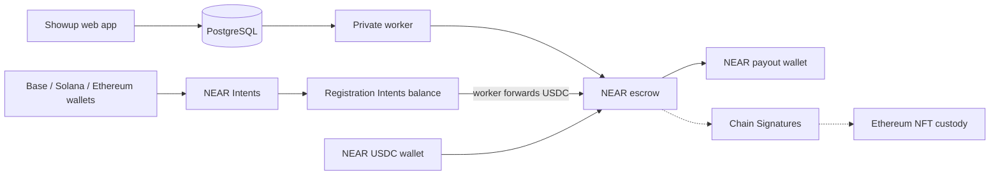

# Showup

**Turn an RSVP into a refundable commitment.**

Free RSVPs are cheap, so people don't show up. Showup asks attendees to put down a small
deposit. Show up and you get it back. Don't, and your deposit is split among the people
who did. Hosts can add a prize — a USDC pot, an NFT, or both — that one attendee wins.

Showup is being built for deposits from **NEAR, Solana, Base or Ethereum**. NEAR Intents converts the
deposit, and the money sits in a Showup escrow contract on NEAR that enforces the rules:
the host never holds attendee funds and never receives a share of forfeited deposits.
NFT prizes stay on their own chain and are released by the NEAR contract through
NEAR Chain Signatures.

> Attendees fund the commitment. Hosts fund the excitement.

## Status

V1 is in active development: one complete loop on mainnet — publish, deposit from any
of the four chains, check in, settle, prize. See [current state](CURRENT_STATE.md) for
exactly what works today and [the plan](docs/plan.md) for V1 progress and the V2 roadmap.
The separate V1 contract is deployed at
[`showup-dev-14989f.near`](https://nearblocks.io/address/showup-dev-14989f.near).
Its reviewed money paths pass sandbox tests, and a manual mainnet 1-USDC deposit,
cancellation and full refund succeeded; [transactions](docs/plan.md#v1-evidence).
Host publication runs from the app into mainnet with or without a host-funded USDC
prize. Browser checks with a preauthenticated test host verified a real 1-USDC prize,
publication and full cancellation refund. Public terms are checked against two
mainnet RPCs. Attendees can now register and deposit native USDC from a verified NEAR
wallet, with funded-seat confirmation and a verified full cancellation refund.
Base, Solana and Ethereum deposits also pass the real browser journey through
NEAR Intents: each funded 1 USDC in escrow and received its full cancellation refund
in the locked NEAR payout wallet. [Transaction links](docs/plan.md#v1-evidence).
Live-code check-in, host/deadline
closing and fixed-wallet payout receipts now work in the real app on mainnet: two
1-USDC deposits and a 0.25-USDC prize settled into a verified 2.25-USDC payout to
the checked-in attendee. Test USDC was restored in full. Ethereum NFT custody,
recipient binding and release controls are implemented locally and pass synthetic
browser/database checks. The selected NFT is finalized in its derived Ethereum
custody address; its signed mainnet release remains unverified.
[Build and test it](docs/setup.md#v1-escrow-build).

## How V1 works

1. **Host** signs in, creates an event (time, deposit, capacity, optional prize) and
   publishes it to the escrow contract.
2. **Attendee** connects a wallet on NEAR, Solana, Base or Ethereum, reviews the deposit
   and fees, and commits. NEAR Intents routes the deposit into USDC in escrow.
3. **At the event,** attendees check in and the host sees attendance live.
4. **At close,** the contract returns deposits, splits no-show deposits among attendees
   and draws the prize winner. Everyone gets a receipt with explorer links.

## Architecture

- **Web app:** Next.js and TypeScript, PostgreSQL, and a background worker
  ([ADR-0001](docs/adr/0001-application-and-authentication.md)).
- **Escrow contract:** Rust on NEAR (`contracts/showup-v1` for V1; `contracts/showup`
  retains the V2 prototype).
- **Cross-chain deposits:** NEAR Intents 1Click API.
- **Cross-chain prizes:** NEAR Chain Signatures ([ADR-0002](docs/adr/0002-nft-custody.md)).



The dotted NFT path is implemented locally; its mainnet custody/release proof remains open.

## Run it locally

See [setup](docs/setup.md). The home page explains the loop; `/preview` lets anyone
try the V1 rules without saving or funding an event. `/host` uses authenticated host
access, and attendees follow their event's invitation link.
The full product vision is in the [PRD](docs/prd.md).
Project wallet addresses (no keys) are in [development wallets](docs/development-wallets.md).

## Repository checks

Git and Python 3 are required for the repository checks. On each new clone:

```sh
sh .standards/setup-hooks.sh
sh .standards/check-standards.sh
```

Setup activates the commit template and Git checks, preserving any existing
active hooks. See [standards maintenance](.standards/README.md) for scope and provenance.
