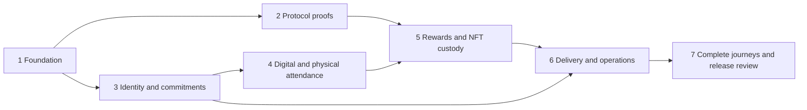

# Showup plan

This is the single task tracker. The full product vision lives in [the PRD](prd.md);
what works now lives in [current state](../CURRENT_STATE.md). Working rules and
authority live in [AGENTS.md](../AGENTS.md).

The plan has three parts:

1. **V1** — one complete working loop on mainnet. This is the current goal.
2. **V2 roadmap** — the rest of the PRD, kept intact for later.
3. **Reference** — the earlier plan and its evidence, superseded but kept for history.

## V1 goal

A host publishes an event. Attendees commit a small deposit from **NEAR, Solana, Base
or Ethereum**; NEAR Intents converts it and **USDC lands in the Showup escrow contract
on NEAR mainnet**. Attendees check in at the event. When it closes, the contract:

- returns each attendee's deposit (less disclosed transaction fees),
- splits no-show deposits equally among attendees (never to the host), and
- if the host added a prize, draws one attendee to receive it: a USDC prize pot,
  an **ERC-721 NFT held on Ethereum mainnet** and released by the NEAR contract through
  Chain Signatures, or both.

Everything runs in the real web app against real contract state, with transaction
links anyone can check on block explorers.

### V1 simplifications (deliberate; the PRD version is V2)

| Area | V1 | V2 (PRD) |
| --- | --- | --- |
| Payout destination | USDC on NEAR to the attendee's NEAR account (stretch: back to the source chain via Intents) | Default payout on the funding chain, any supported chain |
| Rewards | Forfeitures split equally + one optional draw prize (USDC pot and/or Ethereum NFT) | Sponsor budget with 40/60 hybrid, equal-only and draw-only presets |
| Draw randomness | NEAR on-chain randomness from the contract is acceptable | Bound, recoverable verifiable-randomness request (section 15) |
| Attendance | One mode, chosen by what is most complete: personal QR scanned by host, or host live code | Both digital and physical modes, Telegram code replies |
| NFT prize networks | Ethereum mainnet ERC-721 via Chain Signatures | NEAR, Base, Solana and Ethereum |
| Participation | None | Quizzes, daily streaks, series badges |
| Notifications | None | Telegram bot reminders and receipts |
| Access | Host sign-in as already built; attendees sign in and connect a wallet | Invitation roles, account export/deletion, recovery links |
| Failure handling | Clean cancel/abort that returns principal; basic retries | Full crash/outage recovery, fee caps, fail-neutral evidence checkpoints |

Keep existing code for V2 features in place but out of the V1 user path (hidden or
flagged off). Do not delete it.

### Mainnet budget

V1 mainnet budget: **50 USD total** across NEAR, Solana, Base and Ethereum, covering
contract storage collateral, deposits, gas, Intents fees and the NFT. NEAR Intents has
no testnet, so cross-chain routes are exercised on mainnet with small amounts. If
contract storage collateral pushes the total past the budget, shrink the contract
(for example by moving V2-only code out of the deployed build) before asking for more.

First-round preparation (November 4): [wallet amounts](development-wallets.md#mainnet-preparation-and-initial-funding)
sum to **$11.77 including 2.54 NEAR USDC** at the preparation prices.
Public key metadata matches all three addresses. External-chain funds have arrived
as recorded below. NEAR activation, USDC storage registration and **2.549953 native
NEAR USDC** are finalized. First-round funding is complete on all four networks.
Selected NFT: [BasedHeads #2829](https://etherscan.io/nft/0x42dc0cecefbaf8e81d631a75fa212510c347f66b/2829),
Ethereum ERC-721 `0x42dc0cecefbaf8e81d631a75fa212510c347f66b`. Two finalized RPC
reads agree on ERC-721 support and ownership by the external funding signer; no
NFT transfer. V1-1 now builds a separate `showup-v1` contract from the existing
workspace, keeping all V2 modules intact and outside the V1 artifact. V1 trusts
the local app operator for host/attendee wallet binding, attendance and observed
NFT custody; contract code enforces token receipts, fixed beneficiaries and payouts.
Measured corrected V1 WASM: **321,207 bytes**, code collateral **3.21207 NEAR**;
SHA-256 `3efb9c95ab79e6d996694a99da4a762f5896a39676063c7c49589a0ecde8b063`.
Deployed atomically to `showup-dev-14989f.near` using the existing key;
the prior **3.66-NEAR quote is withdrawn**. Corrections pass locally and in CI.
The controller received **3.73 wNEAR**, verified at `wrap.near` by both RPCs, and
[converted it to native NEAR](https://nearblocks.io/txns/FfCBFBUXrGQQQiyvWgjV65HuE2SdsddYjgYfet3zvxV2).
Both RPCs verify **3.9774802711174997 native NEAR and zero wNEAR** at block 223111055.
No replacement transfer is needed. At the
[funding snapshot of $4.05/NEAR](https://www.coingecko.com/en/coins/near), the new
allocation is about **$15.11**, or **$27.20/$50** including prior funding and known
fees, before the sender's new fee. Original calculation: code 3.21207 + 0.10 state
allowance + 0.40 contract gas reserve + 0.25 controller reserve − existing
0.2485110692734984 = 3.7135589307265016 NEAR, rounded up to **3.72 NEAR**.
Three-attendee settled state uses 1,896 bytes above code, within the 10,000-byte
allowance. Factory, key, protocol and balances were rechecked before deployment.
The existing owner key retains deployment/upgrade authority. Account funding is
3.71207 NEAR, including code collateral, state allowance and gas reserve.
Reserve **$1 for NFT custody gas**; the remaining budget covers routing/other fees.
NFT custody gas is provisionally 0.0001 ETH ($0.24), to be simulated for the chosen
NFT before transfer; no NFT purchase is planned. These allocations do not establish
every later V1 operation's final cost. The retained V2 WASM is 1,208,397 bytes and
is outside the V1 deployment. No NFT move has occurred.

## V1 work packages

Work in this order. A package is done when its acceptance line is true in the real app
and its evidence row below has tx links. One package may start before the previous one
is fully polished if it is blocked on an external step.

| ID | Package | Acceptance |
| --- | --- | --- |
| V1-1 | **Mainnet escrow** | V1 contract builds with money-path tests passing (deposit, refund, forfeiture split, draw, NFT release, cancel). Deployed to a NEAR mainnet account; storage collateral and account recorded. One manual 1–2 USD USDC deposit and refund round trip succeeds. |
| V1-2 | **Publish an event** | A signed-in host creates an event in the app (title, time, deposit amount, capacity, optional prize) and publishes it to the mainnet contract. The public event page shows the live on-chain terms. |
| V1-3 | **Deposit from NEAR** | An attendee signs in, connects a NEAR wallet, sees the deposit and fee breakdown, deposits USDC (or NEAR converted via Intents), and the app shows the seat as confirmed only after the escrow receipt is observed on chain. |
| V1-4 | **Deposit from Base, Solana and Ethereum** | Same journey from a Base wallet, a Solana wallet and an Ethereum wallet using the NEAR Intents 1Click API: quote → wallet approval → live routing status → USDC confirmed in escrow and bound to that attendee's registration. Order: Base, Solana, Ethereum. |
| V1-5 | **Check-in** | Attendees check in at the event through the chosen mode; the host sees who is checked in, live. Check-ins are recorded against the funded registration and reach the contract at close. |
| V1-6 | **Close and settle** | Host closes the event (or the deadline closes it). Contract returns attendee deposits, splits no-show deposits equally among attendees, and draws the prize winner. Attendees see their receipt: deposit back + share + prize, with tx links. Host sees a results page. |
| V1-7 | **Ethereum NFT prize** | Host attaches an ERC-721 on Ethereum mainnet. It moves into a Chain Signatures–derived custody address controlled by the escrow contract before publication. At settlement the contract signs its transfer to the winner's Ethereum address; the app shows the Etherscan link. Cancel returns it to the host. |
| V1-8 | **Refund to source chain (stretch)** | Attendees who deposited from Base, Solana or Ethereum receive their USDC back on that chain via Intents. Skip if V1-1 to V1-7 are not solid. |
| V1-9 | **Polish and front door** | Landing page that explains Showup in one screen; event, deposit, check-in and results screens look finished on desktop and phone; live status animations for routing and the draw reveal. README rewritten to describe exactly what runs, how to run it from a fresh clone, the architecture (diagram) and the mainnet contract and tx links. Fresh-clone setup verified. |

### V1 evidence

One concise row per package; distinguish local preparation from mainnet completion.

| ID | Date | Evidence |
| --- | --- | --- |
| V1-1 complete | 2026-11-04 | Reviewed 321,207-byte artifact [deployed/initialized atomically](https://nearblocks.io/txns/9HeV9x7NKZ6PZixzLWbDebcJu4ophRoym5EmEg52nsCR) at `showup-dev-14989f.near`; code collateral 3.21207 NEAR. Manual [1-USDC deposit](https://nearblocks.io/txns/DZF1Tuvq7kTU18t8y8jyEcBjh7Z8YL4eNyoFnWnn6nNX), [cancel](https://nearblocks.io/txns/J9RnpzsatiSJmriG1BJRfsD6fBivTtK9FdMUw8ToNVye) and [refund](https://nearblocks.io/txns/BsxTU3pK65apU6mz7cajh6tkoEU1x3XY2iTAfzWwAsnS) restore 2.549953 USDC to the controller, zero in escrow, claim paid in full. Both RPCs agree at finalized block 223121252. The identical artifact retains its 53-test/Node replay [CI evidence](https://github.com/gueysito/show-up/actions/runs/41952837163); 109 current app/operator unit tests, format/lint/types and build pass. Next: V1-2 app publication. |
| V1-2 complete | 2026-11-05 | The app supports [zero-prize publication](https://nearblocks.io/txns/3Fn5FDSUu9vDXqor28yHGjKAH489D96h3wznJhUsxaca) and a real [1-USDC host-funded prize](https://nearblocks.io/txns/97ykKBBkmiJ9UJnumoNss5oXkdhgSh7sQdnY7e3iM4mq), [publication](https://nearblocks.io/txns/3HRPSdJqxRUEDjwWtGW53oXc6mam7jWyRvE7acVGg6s9) and [full cancel/refund](https://nearblocks.io/txns/Aa2521htpgPDxQuwnXD5Zz9LyKLzNgRpLxcSvMbCkK68). Mobile browser verifies live terms; 112 unit, 189 database, 46 ordinary browser cases and focused token-refund/independent-decoder sandbox checks pass, plus build/code checks. Auth used a preauthenticated host and isolated owner-wallet approval, not live provider/external wallet UI. Next: V1-3 deposits; NFT remains V1-7. |
| V1-3 complete | 2026-11-05 | An attendee prepared its owned NEAR wallet, [registered](https://nearblocks.io/txns/3PcvqJPn8wSxxNkumbt8ZiuGZ9kKqgmRpQMsWBJBhuHv), approved a real [1-USDC deposit](https://nearblocks.io/txns/JCi8SuJpQ2eBUFoyrbXtQkwRJGdccJ2BCquH7gun1P4B), saw its funded seat in the mobile browser, and received a [full cancel/refund](https://nearblocks.io/txns/GRiMCKFTzYCM2qtD516F2gt8vv6PTCDqm927H62G785H). 113 unit, 190 database and 46 ordinary browser cases plus independent native-USDC decoding pass; the live browser case passes with paced RPC reads. Engineering host/wallet qualification remains as in V1-2. Next: V1-4 Base, Solana, Ethereum. |
| V1-4 prepared; provider blocked | 2026-11-05 | Owned source/payout binding, signed exact-output quotes and Base/Ethereum USDC wallet transfers pass 115 unit/191 database cases and build/code checks. Routing status and source hashes cannot fund a seat. Read-only Base/Solana USDC→NEAR USDC probes return HTTP 400 “Quoting for this pair is not available”; current provider token IDs still match. No cross-chain funds sent. Solana wallet transfer remains to connect. Continue V1-5/6 independently. |
| V1-5/6 local implementation | 2026-11-05 | Host live codes bind to funded owned registrations; original-hash worker recovery, close ordering, fixed-wallet receipts, failed-transfer retry and restricted-account withdrawals pass 115 unit, 193 database and 46 ordinary browser checks plus build/code checks. Deadline closing cancels after failed accepted check-ins. Mainnet browser round trip remains; contract artifact is unchanged. |

Tooling watch: npm audit reports eight moderate findings through the ESLint
`minimatch` dependency, with no published fix; no high advisories. This dependency
is development tooling, not a runtime publication/payment dependency.
GitHub [run 41991538690](https://github.com/gueysito/show-up/actions/runs/41991538690)
did not start any jobs: account billing/spending limit requires owner attention.
Continue local checks; do not rerun jobs or weaken required checks.

**Predeployment review, November 4:** target `3c2d32f43266aff7e1f156326f146ad1091781a6`
and original WASM `365a94695dba3d92a88cc33ad5a67443b9ea1def217b24fe9b80aa3aba3d526f`; source was unchanged during review. Five extra
cases ran in an isolated snapshot under `contracts/.cache/security-review/`.

| Priority | Finding / condition | Evidence and required follow-through |
| --- | --- | --- |
| P1, corrected locally | Late, duplicate or rejected routed receipts could strand principal at the Intents sender. | Official [Intents withdrawal rules](https://docs.near-intents.org/integration/verifier-contract/deposits-and-withdrawals/withdrawals) provide no automatic refund when `msg` is specified. Known receipts from the bound sender now create `recovery:<registration>` credits for the fixed NEAR beneficiary, including wrong amounts, full/closed/late and duplicate cases. Tests move actual mock tokens from one shared sender to distinct payout accounts and conserve every unit. In-flight amounts are separate from newly credited funds, including failed withdrawals. No live loss experiment. |
| P2, corrected locally | Failed NFT signing could not be retried without an existing signature. | Operator-only `retry_nft_signature` accepts one yoctoNEAR and reuses only the original transaction, up to three total attempts; attempt-bound private callbacks reject stale replies. Failure, invalid response, successful retry, authorization, altered transaction and exhausted-limit reconciliation cases pass. No mainnet signing/custody yet. |
| Deployment control, verified on mainnet | Deploy and initialize atomically. | Constructor rejects external callers. Sandbox outsider rejection and self initialization pass. [Mainnet deployment plus `new`](https://nearblocks.io/txns/9HeV9x7NKZ6PZixzLWbDebcJu4ophRoym5EmEg52nsCR) ran in the same self-signed batch; both RPCs confirm the pinned code hash and sole retained key. |

Controls that held: forged callbacks were rejected; concurrent withdrawals paid
exactly once to the fixed recipient. A 64-seat / 32-attendee settlement conserved
64 USDC, burned 12.9 Tgas, and used 19,814 state bytes above code (within the quoted
account's free balance; the earlier 10,000-byte allowance was for the small demo).
Real 1Click dry pricing accepted and signed the exact `deposit:` message; this is
not a funded route proof. Live `v1.signer` config requires 15 Tgas and its advertised
3.17.0 source requires 1 yoctoNEAR; our call uses 60 Tgas/1 yocto and matches its
wire format. The selected ERC-721 owner-to-EOA dry transfer succeeds (68,296 gas).

Accepted local-pilot trust remains the operator's wallet/attendance/custody binding
and retained full-access upgrade/spending key. This review did not remove that
authority, independently audit providers, reproduce their deployed binaries, or
exercise mainnet routing/signing/custody. App auth/database/browser code is unchanged;
current CI checks pass. Corrections add no dependencies. Invalid references
or wrong senders remain rejected and must be prevented when binding a route. Three
failed NFT attempts still require an original signature or explicit operator recovery;
retained full-access authority remains deliberate. Mainnet deployment is recorded
below; the review's money-path evidence still applies to the identical artifact.

### Mainnet spend ledger

| Date | Chain | Purpose | Amount (USD) | Tx |
| --- | --- | --- | --- | --- |
| 2026-11-04 | Solana | Incoming owner funding, finalized | 0.003 SOL + 2.54 USDC (about $2.83) | [SOL](https://solscan.io/tx/4cGYQ8bNTQMoXSP8brNqWMRVDvAeHjWeadX8D1PQtqyn8HQ2cL52gQvPqxdDTmwFfycDtiwbEjrXRwsUCvJCgihL), [USDC](https://solscan.io/tx/45HDmpqsdM26fof7N49heELoeyfT1WphcxYg9AzBMfuNQM7zd6CfRbErJu1C8VMigDsHAdGj9HXgbvgRDZAQ8z4g) |
| 2026-11-04 | Base | Incoming owner funding, finalized | 0.00002 ETH + 2.54 USDC (about $2.59) | [ETH](https://basescan.org/tx/0x5d074bac6720dfc6cc8c1c0a876e26569aa047ce967f450e1b4ced6b6c7805aa), [USDC](https://basescan.org/tx/0x1a3b4abd66fcd3f3d1948e0e77fca6a9e2585851a914d53bacae93cadfb15368) |
| 2026-11-04 | Ethereum | Incoming owner funding, finalized | 0.0001 ETH + 2.54 USDC (about $2.78) | [ETH](https://etherscan.io/tx/0x79e2421b91abf5a75c2acf18f38c98699663e4d0331dc9fa8f31d854f5ddc57c), [USDC](https://etherscan.io/tx/0x27fb816b8c199685e356617ccd3a524fa5e703d49e41e61e09870c0ff6cf29ce) |
| 2026-11-04 | Solana | Owner-paid funding fees; separate recoverable USDC account rent | 0.000159934 SOL fees (about $0.0153); 0.00148844 SOL rent (about $0.1425) | Same two Solana transactions above |
| 2026-11-04 | Base | Owner-paid funding fees, execution plus L1 | 0.000000514133340788 ETH (about $0.0013) | Same two Base transactions above |
| 2026-11-04 | Ethereum | Owner-paid funding fees | 0.000052962733677352 ETH (about $0.1288) | Same two Ethereum transactions above |
| 2026-11-04 | NEAR | Incoming owner funding and implicit activation, finalized | 0.25 NEAR (about $1.03) | [Funding](https://nearblocks.io/txns/BKik9NVc6nVhfRhZE9eh7Z5hTgDEBVSTZ7HqVQjEA4C8) |
| 2026-11-04 | NEAR | Owner-paid funding/activation fee | 0.0071149895375 NEAR (about $0.0293) | Same NEAR funding transaction above |
| 2026-11-04 | NEAR | USDC storage registration, finalized and verified by both RPCs | 0.00125 NEAR collateral (about $0.0052); 0.0002389307265016 NEAR consumed fee (about $0.0010) | [Registration](https://nearblocks.io/txns/8FR3jtZ8QK2VBjRWbraLsRgUE3Nogy8J9bhDhHR46Wn7) |
| 2026-11-04 | NEAR | Net incoming USDC, both RPCs agree at finalized block 223088071 | 2.549953 USDC (about $2.55) | [Account](https://nearblocks.io/address/14989fbcef30b7cfabafb3380a4b707e71513eec2b22ffc6f8b8ff7cd95a11cc); token-transfer hash not yet indexed |
| 2026-11-04 | NEAR | Incoming deployment funding in canonical wNEAR, converted 1:1 into native NEAR | 3.73 wNEAR / NEAR (about $15.11 at the funding snapshot); count once | [Conversion](https://nearblocks.io/txns/FfCBFBUXrGQQQiyvWgjV65HuE2SdsddYjgYfet3zvxV2); incoming transfer hash not yet recorded |
| 2026-11-04 | NEAR | wNEAR conversion fee, paid from existing funding | 0.0010307981559987 NEAR (about $0.0042); no additional allocation | Same conversion transaction above |
| 2026-11-04 | NEAR | Create named escrow account with the existing key | 0.0074439708099973 NEAR consumed fee | [Creation](https://nearblocks.io/txns/BnqNVM6DaBrreUeSBYrEFgNC1eAcnqLTGSHiA9DoZzFB) |
| 2026-11-04 | NEAR | Fund escrow from the controller; internal allocation | 3.71207 NEAR moved, including 3.21207 code collateral; 0.0000446365125 NEAR fee | [Funding](https://nearblocks.io/txns/G8yrmiiBnEiN9az8FiTNWYHXYbKHHMvYKD3mMZPPB8hH) |
| 2026-11-04 | NEAR | Deploy reviewed artifact and initialize in one self-signed transaction | 0.0025062797387012 NEAR consumed fee | [Deployment](https://nearblocks.io/txns/9HeV9x7NKZ6PZixzLWbDebcJu4ophRoym5EmEg52nsCR) |
| 2026-11-04 | NEAR | Register the escrow for native USDC | 0.00125 NEAR storage collateral; 0.0002369083217194 NEAR fee | [Storage](https://nearblocks.io/txns/GirjZVYRTZAJsST82jRx2ZaFqARkjveGA6AND5Hj31p8) |
| 2026-11-04 | NEAR | Create/publish manual smoke event and register attendee | 0.0006250973011694 NEAR consumed fees | [Event](https://nearblocks.io/txns/2d3c9QchQ3nLC4aPuRwtFuPsdJK94TdCRfPjNb5w8Vsn), [publish](https://nearblocks.io/txns/BbXeLfCi6SuJD2KrPjCHD21ucbACzwwFxbwjPbkWiifw), [register](https://nearblocks.io/txns/EeCuByd87FCKUnRhDCEiruuJhve2WuZx5sDgFjF9H34y) |
| 2026-11-04 | NEAR | Deposit exactly 1 USDC into escrow | 1 USDC moved, subsequently refunded; 0.0007233935720751 NEAR fee + 1 yoctoNEAR | [Deposit](https://nearblocks.io/txns/DZF1Tuvq7kTU18t8y8jyEcBjh7Z8YL4eNyoFnWnn6nNX) |
| 2026-11-04 | NEAR | Cancel event and pay its fixed attendee refund | 1 USDC returned; 0.0009131164755953 NEAR fees + 1 yoctoNEAR | [Cancel](https://nearblocks.io/txns/J9RnpzsatiSJmriG1BJRfsD6fBivTtK9FdMUw8ToNVye), [withdraw](https://nearblocks.io/txns/BsxTU3pK65apU6mz7cajh6tkoEU1x3XY2iTAfzWwAsnS) |
| 2026-11-04 | NEAR | Browser-requested atomic create/publish, zero-prize event | 0.0003733713005891 NEAR consumed gas (about $0.0015 at the recorded $4.05 snapshot); no USDC moved | [App publication](https://nearblocks.io/txns/3Fn5FDSUu9vDXqor28yHGjKAH489D96h3wznJhUsxaca) |
| 2026-11-05 | NEAR | Prize funding/recovery check; browser assertion interrupted publication, fixed locally | 1 USDC funded and fully returned; 0.0017832973709019 NEAR gas + 1 yoctoNEAR | [Create](https://nearblocks.io/txns/AKSX1VEkF2P5ym4PDjYvheGbb5mjfbojsaAgdf6wqiji), [fund](https://nearblocks.io/txns/5LuRxoELX4yA4TJRvmwv8kuUY3Dx1gB11BYdQkrRxWSa), [cancel/refund](https://nearblocks.io/txns/7eUy7mdHvFv4j41xPvDWafZML5ixXwnpTK3HLmfybAv4) |
| 2026-11-05 | NEAR | Complete app prize publication and cancellation round trip | 1 USDC funded and fully returned; 0.0019873223215888 NEAR gas + 1 yoctoNEAR | [Create](https://nearblocks.io/txns/8gWAdcuPBG3ok8yUUav8KxevKioPgtoAy4Lh7rWtEpb6), [fund](https://nearblocks.io/txns/97ykKBBkmiJ9UJnumoNss5oXkdhgSh7sQdnY7e3iM4mq), [publish](https://nearblocks.io/txns/3HRPSdJqxRUEDjwWtGW53oXc6mam7jWyRvE7acVGg6s9), [cancel/refund](https://nearblocks.io/txns/Aa2521htpgPDxQuwnXD5Zz9LyKLzNgRpLxcSvMbCkK68) |

| 2026-11-05 | NEAR | Native deposit/refund check; phone-layout correction followed | 1 USDC fully returned; 0.0022161983126886 NEAR gas + 1 yoctoNEAR | [Create/publish](https://nearblocks.io/txns/22XPNVtHX4EHzWFJAeQTSXz4bn7j241gAF5iJiDcqYof), [register](https://nearblocks.io/txns/DvAG6FoVaWUat83wZG1BnBigT73WVN9krqPNf833uUky), [deposit](https://nearblocks.io/txns/8FKnwaNWG6yDAGuabACyjxHmQJKyuV82usLivGzvVXKi), [refund](https://nearblocks.io/txns/HFKozCzYQHViAjXsUgyEnWpPeEfA75831qoGVhKpK1EY) |
| 2026-11-05 | NEAR | Native deposit/refund check; RPC throttling corrected with shared pacing | 1 USDC fully returned; 0.0022166557936494 NEAR gas + 1 yoctoNEAR | [Create/publish](https://nearblocks.io/txns/6LtJUyXt2rtSTZzpkscsxBX5SEDku5x86GGUCtuFyEde), [register](https://nearblocks.io/txns/6mdnGBgVm4H26RwLbPFnaq8KenYFQdj2pVDckLQSVFFv), [deposit](https://nearblocks.io/txns/7mXmEcSL12PKpZbBNiEe5RAaDa4MoT3yBZ84C65aCGLu), [refund](https://nearblocks.io/txns/62powGkye6HqtAzEmuTigJqYLCoHwzF5UQZwR9PiK9mC) |
| 2026-11-05 | NEAR | Complete native-USDC attendee browser journey and refund | 1 USDC fully returned; 0.0022184802873030 NEAR gas + 1 yoctoNEAR | [Create/publish](https://nearblocks.io/txns/B2Q1YkKiuFjvLwDNxLjvShdpbvmPtnYkohnhv9xL5DKT), [register](https://nearblocks.io/txns/3PcvqJPn8wSxxNkumbt8ZiuGZ9kKqgmRpQMsWBJBhuHv), [deposit](https://nearblocks.io/txns/JCi8SuJpQ2eBUFoyrbXtQkwRJGdccJ2BCquH7gun1P4B), [refund](https://nearblocks.io/txns/GRiMCKFTzYCM2qtD516F2gt8vv6PTCDqm927H62G785H) |

November 4: about **$27.20 funded/allocated including known sender fees and Solana rent**,
using the recorded funding price snapshots. All execution fees and the escrow's
3.71207-NEAR funding come from received funds, not additional allocation.
Total agent-consumed gas: **0.0245584570009788 NEAR** (about $0.0995 at $4.05/NEAR).
After the prize/deposit round trips, controller native balance is **0.243377822737722399999994 NEAR**;
escrow native balance is **3.709563720261298799999994 NEAR**, including code/state
collateral. Both accounts have USDC storage registration. Both RPCs confirm
**2.549953 USDC in the controller, zero in escrow**, with cumulative accounting
6 USDC received, 6 paid and zero held at finalized block 223137414. Internal transfers
and returned principal are counted once.
The initial USDC sender attribution and latest incoming wNEAR sender fee remain
unindexed/unrecorded. The public NEAR RPC throttled publication; manual recovery
rebroadcast only the identical signed image after both replacement providers
reported it unknown and the signer nonce unchanged. No new nonce or duplicate
execution; subsequent calls use FastNEAR with independent dRPC state comparison.
Native-USDC deposits now work in the app; cross-chain routing and NFT movement remain later V1 packages.

CI maintenance, November 4: feature pushes select app/contract jobs by changed paths;
docs-only pushes skip heavy jobs, while PRs/main/manual runs retain full validation
and stable required-check names. CI-routing-only pushes use lightweight scope tests;
scope-test failures fail the required checks. Superseded runs cancel automatically. Local scope
tests and workflow validation cover selection/failure cases. V1-4 is next. The earlier prize test timestamp fixture was corrected after its CI failure.

## V2 roadmap

The rest of the [PRD](prd.md), in rough priority order. Existing code and ADRs for these
remain the starting point.

1. Payouts on any supported chain by default; destination changes with proof of control.
2. Sponsor reward budgets with equal-only, draw-only and 40/60 hybrid presets.
3. Verifiable, recoverable draw randomness (PRD section 15) and prize acceptance/decline/replacement.
4. Both attendance modes, with Telegram code replies.
5. Quizzes (up to two per event) and daily streaks with the 1.25× boost; series badges.
6. Telegram bot: reminders, check-in prompts, quiz buttons, receipts.
7. NFT prizes on NEAR, Base and Solana in addition to Ethereum.
8. Host invitations and roles, account export and deletion, own recovery links.
9. Fee caps, requotes, route minimums and full per-route acceptance tests (PRD section 8).
10. Crash/outage recovery, fail-neutral evidence checkpoints and reconciliation hardening (PRD section 14).
11. Host results report with cost per verified check-in (PRD section 19).
12. Public hosted deployment and wider (non-invite) access.

## Reference: pre-V1 plan (superseded)

Everything below is the earlier plan and evidence, kept for history and as V2 design
input. Its approvals, gates and "active" goals no longer govern work; V1 above and
[AGENTS.md](../AGENTS.md) do.

This is the single task tracker. Requirements live in [the PRD](prd.md);
maturity and the next action live in [current state](../CURRENT_STATE.md).
Owner approval on November 2, 2026 authorizes the larger halfway slice through
milestone 4: P1–P5, I1–I5, A1–A4 and I3 UX-03–07, preserving F1–F4.
This supersedes the smaller host-workspace proposal and earlier build warnings
for these packages. Local application/contracts, disposable sandbox testing and
project-local tooling are authorized, as are verified private feature-branch
checkpoints. No merge, public deployment, public-network signing/deployment,
mainnet spending, paid purchase, external messages or SSH is authorized.
November 3 exception: the owner approved Circle's prepared free faucet CAPTCHA
and exact native testnet operation `2750f947-d374-424d-9b4c-328379227ada`, approval
hash `161ae1ebbb741e3ca695814f34e97b170a70d80ebb88d529f899d660971d261f`.
Its 20-test-NEAR / 5-test-USDC limits, pinned deployment and bounded original-principal
recovery are authorized. This grants no mainnet, other-network or general deployment authority.
The owner subsequently approved gas-only amendment
`c50abf32e3dd2c80cea170125d6e0c118848f5aab73f469575b38565efd81ca6`:
200 Tgas for the replacement and remaining calls, with the original nonce,
recipient/authorization, no top-up and unchanged principal/native limits.
The owner then approved retained-deployment operation
`8529d901-add9-4b0a-9dab-ae9d43142fee`, exact plan hash
`3487fd2379259bc80d314e1ce0918d1d275c53c6752328a929f435091812aede`:
the specified 1-test-NEAR internal attendee top-up and 5-test-USDC round trip,
200 Tgas per call, retained keys/deployment and the same 20-test-NEAR ceiling.
Execution and original-operation reconciliation are now authorized for that plan.
On November 2 the owner separately authorized the temporary Telegram sign-in
tunnel at `https://liable-pleat-maritime.ngrok-free.dev` and its narrow app
configuration change. This does not authorize other hosts or general deployment.

### Active halfway implementation goal

Goal: working, verified milestone-4 journeys, not a percentage claim. Exposure:
local pilot with fictional data. Existing ADRs and PRD acceptance remain binding.
Ignored `.agents/runs/showup-halfway/` is the owner-approved evidence location,
not another tracker.

Execution order and dependencies:

1. Preflight Google/Telegram registrations, callbacks and credential configuration;
   revalidate Intents, randomness, signing and finality against primary sources.
2. Implement UX-03–07 and P1 manifests; run actual-browser regression checks.
3. Implement I1/I2 identities, explicit linking, revocable sessions, bootstrap
   and atomic invitations, then I3 private drafts/duplication separate from ADR-0003.
4. Prove P2–P5 in local sandbox first. Public engineering-network signing needs
   separate bounded approval; live Intents requires approved mainnet funds.
5. Implement I3 publication gates, I4 commitments and I5 recovery/privacy. P2/G1
   blocks real-money enrollment; provider status or fixtures cannot create real seats.
6. Implement A1–A4 on the shared funded-registration/evidence boundary, including
   principal return/reconciliation for exercised routes and fail-neutral abort.
7. Verify unit/PostgreSQL/contracts, production build/CI, actual browser journeys,
   authorization/ID swaps, timing/replay/races, accounting and restart recovery.
   Separate fixture, sandbox, engineering-network, mainnet and phone evidence.

Acceptance: PRD §18.1 and §20 checks applicable to the named packages. Both social
providers, all four required networks, both attendance modes and exercised principal
returns need actual evidence before the full target is complete. Keep unverified
routes disabled. Rewards/claims/reporting/release in milestones 5–7 remain incomplete.
Credentials, approved assets/budgets, public signing/deployment and actual-phone
checks are external gates, never inferred from offline tests.

November 2 resumption: Google/Telegram setup, explicit linking and return to the
same account are owner-verified; authentication no longer blocks implementation.
November 3 delivery reforecast: **5–8 focused implementation days remain locally**,
excluding external approval/provider/device turnaround. The earlier 3–5-day estimate
treated backend proofs as closer to complete journeys than the code supports:
at reforecast publication was a checklist, commitments exposed read-only history,
and ordinary bot integration was absent. Repeated broad checks also consumed time without closing
those gaps. This is an estimate correction within the original scope, not changed
acceptance. Reuse passing evidence; run focused changed-behavior checks and required
broader checks at integration checkpoints. No additional verification infrastructure
or repeated negative/kill variants without a specific unresolved requirement.

The finite remaining deliverables below decompose existing packages, not new stages:

| Existing packages | Remaining local deliverable | Local effort | External gate before full acceptance |
| --- | --- | --- | --- |
| I3, P1–P5 | Connect saved rules, fixed staff/exclusions and existing protocol adapters to one publication flow with immutable escrow/reserve/prize prerequisites and recoverable status. | 1–2 days | Actual deployment authority, provider/draw/custody qualification, required assets/reserves and bounded signing/spending approval. |
| I4, P2/P5 | Complete event review → verified wallets → quote/fee/destination consent → funding/reconciliation UI and adapter wiring; only verified escrow can book capacity. | 1.5–2 days | Approved real routes and funded deposit/return evidence on NEAR, Base, Solana and Ethereum. No fixture enables deposits. |
| I5 | Connect release/cancellation/return status and settlement-dependent privacy clearance to the original obligations; preserve unresolved recovery. | 0.5–1 day | Qualified settlement evidence before actual clearance/purge and real return completion. |
| A1–A4 | Ordinary optional bot opt-in, event links and sender/prompt-bound code replies on the shared attendance boundary; integrate existing attendance/coverage status and silent mobile/closed controls. | 1–2 days | Bot API credential and explicit message/ingress approval; qualified source/coverage evidence; actual iOS/Android camera, wallet return and audio checks. |
| Existing integration exit | One combined host/attendee walkthrough for both modes, focused gap fixes, required CI and a concrete owner handoff. | 0.5–1 day | Owner/device and public-provider evidence listed above; no full milestone-4 claim without it. |

Local delivery progress: `8ca2941` binds saved drafts/staff to actual native sandbox
publication; `3f21725` connects event wallet/destination review and the signed NEAR
return context; `9937770` connects original recovery status and actual deletion holds.
`9184ccd` adds user-bound release through actual sandbox principal return;
`297770e` implements optional bot consent and bound replies. Existing affected
browser/native evidence is retained. Release CI [41695563149](https://github.com/gueysito/show-up/actions/runs/41695563149)
and engineering-profile CI [41703542800](https://github.com/gueysito/show-up/actions/runs/41703542800)
pass both jobs. `e0f287f` prepared the bounded executor; `c610981` records the
public trial and recovery below, with both [CI jobs](https://github.com/gueysito/show-up/actions/runs/41743437861)
passing. The separately approved retained-deployment result is recorded below.

The previous **2–4 focused local days after qualified protocol paths** estimate
was conditional, not a measured agent-throughput forecast or a delivery promise.
Reforecast the concrete critical path in execution hours after pricing and checking
the required integrations; separate owner/provider/device waiting and unresolved
provider-driven redesign. Do not substitute a shorter unsupported estimate.
The earlier 5–8-day reforecast included the now delivered
publication binding, wallet review, recovery status, user release and ordinary bot
journeys. Remaining: source-dependent publication prerequisites (0.5–1 day),
qualified quote/consent/funding wiring (1–2 days), settlement-dependent clearance
and combined two-mode walkthrough (0.5–1 day). P2/P3/P4/P5 public proofs can reveal
additional implementation work; the current estimate does not assume they pass.
No required route or acceptance criterion is removed. Actual protocol activation,
qualified source coverage, bot messages and devices retain their gates.

November 3 faucet delegation: the agent used the isolated Brave development profile
at the owner's request. The official Docs faucet funded 5 test NEAR; two finalized
sources agree on **14.9999553634875 test NEAR**, sufficient for the prepared native
experiment, and **0 test USDC** at that point. Circle's 20-test-USDC request then
awaited CAPTCHA confirmation. [Funding evidence](development-wallets.md#current-funding-verification).
The owner subsequently approved Circle and the native operation under its
**20-test-NEAR / 5-test-USDC** limits. Two finalized sources confirmed 20 test USDC.
The trial created both accounts, deployed the pinned WASM and published the event.
Its first reservation was rejected before inclusion: required prepaid balance
0.300960527059114 test NEAR exceeded the attendee's 0.25. Both sources confirmed
that rejection; one identical-byte retransmission changed no nonce/signature.
The owner approved the concrete 200-Tgas replacement at the same nonce, retaining
the original image. The replacement finalized with `Authorization expired`.
No escrow funding/release occurred. Approved recovery returned the original 5
test USDC and cancelled the event. Final two-source observation at block 276118428
shows root 20 test USDC, attendee/escrow zero and accounting owed zero.
[Public transaction receipt](evidence/native-testnet-2750f947-d374-424d-9b4c-328379227ada.json).
Executed review artifact: operation `2750f947-d374-424d-9b4c-328379227ada`, SHA-256
`161ae1ebbb741e3ca695814f34e97b170a70d80ebb88d529f899d660971d261f`, at
`/private/tmp/showup-native-engineering-2750f947-d374-424d-9b4c-328379227ada.json`.
It pins the WASM/code, token, accounts, fourteen normal steps and bounded original
recovery. Application keys were never accessed or regenerated. The retained child
accounts/state remain available. `c610981` fixes the missing read-only
access-key query, uses 200 Tgas, blocks new near-expiry financial broadcasts while
preserving original-hash reconciliation, and closes an unfunded published event
during recovery. Focused operator/RPC regressions and full format/lint/types/unit
checks pass; unchanged browser/build/Rust evidence is reused. The post-close driver
check stopped; a separate same-block, two-source observation verified closure and
all balances. The separately approved reuse operation is recorded below;
any further public operation needs exact approval. Other bounded requests remain actual Base/Ethereum/Solana and
MPC/draw/Intents assets/budgets, optional bot token/message approval, and iOS/Android
checks. These remain separate gates, not part of this native approval.
Source-dependent application integration and the combined funded walkthrough
remain incomplete; no full milestone-4 completion is claimed.

Approved reuse operation `8529d901-add9-4b0a-9dab-ae9d43142fee`, plan hash
`3487fd2379259bc80d314e1ce0918d1d275c53c6752328a929f435091812aede`,
at `/private/tmp/showup-native-engineering-8529d901-add9-4b0a-9dab-ae9d43142fee.json`.
It reuses the retained escrow/attendee and original authority keys; it neither
redeploys nor creates/copies keys. Nine normal steps transfer 1 test NEAR from
the project root to the retained attendee, allocate exactly 5 test USDC, create
and publish a fresh event, then reserve/fund/release/withdraw/return that principal.
Calls are capped at 200 Tgas. The 20-test-NEAR total ceiling and at most four
original-recovery images remain; retained native funding/storage is not deleted.
Six normal calls finalized through reservation and actual escrow funding. Both
sources confirmed a funded registration and exactly 5 test USDC in escrow at
block 276127655. Source-read stops consumed the prepared release window before
any release image was saved; the archival source returned repeated HTTP 429s.
The approved recovery then finalized event cancellation, original principal
withdrawal and return of all 5 test USDC to the project wallet. The driver exited
zero after two-source checks of zero escrow obligation, zero attendee tokens and
restoration of at least the original 20-test-USDC root balance; account claims
were released. Keys/accounts remain retained, with no key copies/regeneration.
[Public receipt and exact hashes](evidence/native-testnet-8529d901-add9-4b0a-9dab-ae9d43142fee.json).
An additional combined final snapshot hit rate limiting; reuse the successful
driver checks rather than repeating them. No new combined snapshot or final native
balance measurement is claimed. **Public-testnet normal release remains unproved**; this is
actual engineering escrow deposit/cancellation recovery, not application funding
or mainnet/Intents qualification. This recovered operation cannot reopen deposits.

`48ce63f` adds fixed source/stage diagnostics; `084f76c` checks signer control
before preparing short-lived authority and guards release expiry. This checkpoint
honors explicit `Retry-After` without immediate retries and repeats only a failed
read phase once after a cooldown of at most ten minutes. Signing, submission and
transaction identities are outside that retry boundary. The actual recovery
completed across a 60-second source cooldown without restarting. Focused observed-
regression checks plus format/lint/types/unit pass; unchanged browser/build/Rust
evidence is reused. Both required jobs passed for `d47a0b0` in
[CI 41757130902](https://github.com/gueysito/show-up/actions/runs/41757130902).
All two-source, credential, native-budget and principal gates remain intact.

Initial funding preparation now has [public read/quote evidence](evidence/mainnet-funding-preparation-2026-11-04.json)
and exact owner-transfer instructions in the [wallet guide](development-wallets.md#mainnet-preparation-and-initial-funding).
The existing NEAR public key derives a valid, uninitialized implicit mainnet
address; no private key was read. The proposed initial wallet batch is about
$9.11, including 2.54 USDC per external network and native account/gas allowances.
It excludes deployment: code-only collateral for the current 1,007,612-byte
artifact is 10.07612 NEAR, about $38.09, before state/gas/provider costs. Both
mainnet sources confirm the storage rate; the current artifact rejects mainnet
and external funding, so do not fund/deploy it as-is. Final artifact/costs and
account-registration/signing batches remain prerequisites. No full $20 fit is claimed.
This checkpoint extends actual signed dry pricing to return routes, preserving
gross principal and quoted/minimum net separately. Focused/full unit and static
checks and an isolated production build pass; actual adapter return pricing passes with funding disallowed. No
UI/schema/contract/key/runtime change or public transaction occurred. Existing
browser/PostgreSQL/Rust evidence is reused; source-dependent G1 remains next.

The next local G1 checkpoint verifies the provider quote inside the NEAR contract,
using the pinned Ed25519 key and exact SDK field selection. A real signed quote
passes actual sandbox execution and independent Node replay; signed-field changes
fail, dry fee details stay excluded and the wet deadline collision is disclosed.
Two focused Rust checks, Rust formatting/Clippy/WASM, seven affected JS checks,
format/lint/types and the unchanged 380-version supply-chain gate pass. Existing
application/browser/database/build evidence is reused. This is read-only signature
inspection, not routed authorization, receipt attribution or payout enforcement.
WASM SHA-256 `97dae1e1da800134c0eab64ea58a18a4be07a6ff8d6a17f27ca39d7c49344afe`;
1,022,462 bytes. No public deployment, signing, account creation or owner-runtime
change. The previous public-deployment artifact remains preserved separately;
its recovered operation is not reopened. Next is binding the original wallet
consent and short registration message at the actual routed receiver.

The local receiver now stores the original wallet consent and authenticated quote
before accepting its short registration reference; see
[ADR-0006](adr/0006-routed-registration-binding.md) and the P1–P5 row below.

Original bounded funding handoff: mainnet accounts are not set up. Prepare a current,
minimum-cost funding and P2/G1 experiment plan, with no new signing or deployment.
The owner prefers reuse of the existing project EVM/Solana keys and existing NEAR
key where suitable; do not generate replacement wallet keys. Prepare a verified
NEAR mainnet account/address compatible with the actual deployment plan, then
present funding instructions in order: NEAR, Solana, Base and Ethereum. The EVM
address is shared; chain-specific balances/gas remain separate. Use public metadata
for address preparation, never private key values. If account registration needs
a paid public transaction, present its bounded approval before execution.

Initial external funding target: **at most $20 equivalent across all project
wallets combined, ideally less**. Price the smallest valid principal, gas, account/
contract storage, provider charges, funding-transfer costs and bounded original-
principal recovery before recommending amounts. Reuse returned principal serially
where possible; distinguish recoverable funds/collateral from consumed fees.
Show exact network, asset identity, verified address, atomic/native amount, USD
estimate and fee/recovery ceilings for each transfer. Do not invent an allocation,
claim the entire goal fits this target without evidence, omit a required network
or infer automatic top-ups. If more is necessary, show the exact additional amount
and reason for owner approval. The owner will fund the confirmed addresses; actual
public signing/deployment remains subject to the exact approved experiment plan.
No additional testnet funding is needed for the completed recovery. Separate
draw/custody/asset/source qualification, private bot configuration plus explicit
messages/ingress approval, and iOS/Android evidence remain required for acceptance.

Critical path: publication/escrow binding → attendee commitment and funded capacity →
shared attendance/normal or fail-neutral return → recovery/privacy. Optional bot and
remaining local UI work can progress while external gates stay closed. Finish the
authorized local deliverables, then hand off exact owner actions; do not continue
running merely to accumulate verification evidence. Milestones 5–7 remain excluded.

| Active package | Status | Evidence / next dependency |
| --- | --- | --- |
| External preflight | Google/Telegram development sign-in and linking verified | November 2: owner confirmed Telegram sign-in, refresh, logout and re-sign-in, then explicit Google linking and logout/Google sign-in returning to the exact same account. Aggregate checks confirm both providers on one account without printing identity values. Both fixed issuers use advertised HTTPS `client_secret_post` authentication. Nine focused auth/exchange checks, all 40 current unit tests, format/lint/types and build pass; isolated Chrome shows both provider controls enabled. Correct Google callback/S256 and public account HTTP 200 verified. Exact-host production-only loopback launcher and anonymous-workspace 404 checks remain verified. This checkpoint records the setup follow-up; separate phone evidence and mainnet funds/public signing/service-budget gates remain open. [Setup and commands](setup.md#approved-ngrok-sign-in-check). Runtime audit: zero vulnerabilities. |
| UX-03–07 | Implemented; locally verified | `770424a` (private CI passed): 7 unit, 12 PostgreSQL and 11 Chromium checks; desktop/mobile browser inspection. [Evidence and exclusions](verification.md#halfway-ux-checkpoint-november-2). |
| P1–P5 | Transfer readers verified; zero-principal NEAR registration proposal prepared; actual routing remains next | `ae6832f` adds actual retained NEAR/Base two-source transfer reads and offline four-network readers; this checkpoint prepares a pinned-factory, zero-deposit named-controller call with one image, no write retries and a 0.102-NEAR total cap, with actual mainnet read agreement and focused absence/key/fee-boundary checks. Funding and signing/runtime approval remain unconfirmed; final artifact/provider costs, actual G1 entry/return, monetary observer qualification, app reconciliation, draw/custody/coverage and full milestone 4 remain incomplete. Unchanged Rust/advisory/browser/database/build evidence is reused; no new public transaction, credentials or owner-runtime change. [Transfer evidence](evidence/token-transfer-reads-2026-11-04.json), [registration proposal](development-wallets.md#unsigned-named-account-registration), [funding limits](development-wallets.md#cost-and-recovery-boundaries). |
| I1 | Development sign-in/linking verified; optional bot identity prerequisite added | This checkpoint preserves the signed Telegram `profile.id` separately from OIDC `sub`, encrypted in the same identity record; legacy enrichment keeps the original account, rejects changed bindings and collects nothing new during restricted recovery. Own export includes the retained ID. 78 unit, 176 PostgreSQL, seven affected Chromium journeys and isolated build/static checks pass; the new regression fails against the old writer. Owner-verified Google/Telegram sign-in/linking remains prior evidence; no owner app/key change, bot-message consent, actual-phone or release claim. [Setup](setup.md#secure-local-identity-setup). |
| I2 | Implemented; isolated verification passes | `ac19b14` (private CI passed): admin-only 15-day host links, event-scoped host/admin links, consent, atomic redemption/replay, unused expiry/revocation, encrypted link recovery and shared limits. The live sign-in gate is cleared; the full admin-to-host walkthrough remains to be exercised. |
| I3 | Saved-rule publication bound in sandbox; live prerequisites gated | `8ca2941` binds normal saved drafts/fixed staff to one encrypted salted material image and actual native publication. Both-mode attended/outage principal journeys and affected host/privacy browser checks pass; CI41690057149 passes. Qualified escrow, reserve/prize/provider evidence and public authority remain prerequisites for live publication. [Publication](setup.md#publication-requirements), [decision](adr/0005-publication-material-commitment.md). |
| I4–I5 | Wallet continuity, recorded limits and original recovery integrated; live money/clearance pending | `0a96092` preserves choices across wallet returns; `7836a92` itemizes original four-network input/gas precision, routing/delivery/platform limits and distinct financial expiries. This checkpoint applies the same event/browser timezone display to event start/end, registration review and the release deadline. Static/unit checks, isolated production build and six focused existing browser journeys pass, including both-mode entry, exact UTC attributes, own financial-history/ownership/logout and attendance controls. Mobile captures and logs: `/private/tmp/showup-event-times.mpd3c3pp/test-results/` and `/private/tmp/showup-event-times-{check,build,browser}.log`; M4 Node 26.12.1/npm 11.19.1 and pinned Chromium, disposable DB55433. Unchanged backend/native evidence is reused. Qualified quotes, attributable four-network funding, live publication and settlement-dependent clearance remain incomplete. [Review/recovery and limits](setup.md#financial-consent-preparation). |
| A1–A4 | Local bot, code/QR entry and timezone display integrated; qualification remains | `297770e` implements optional event prompts and bound code replies on the shared ledger; both [CI jobs](https://github.com/gueysito/show-up/actions/runs/41678300150) pass. This checkpoint displays both timezones for digital and personal-QR opening/grace/cutoff, staff scan windows and host code expiry under PRD §7. The six focused browser journeys above cover these displays and existing pending/retry and synthetic camera behavior; no new test cases, timing rules, server authority, dependencies or migrations. Actual API/messages, qualified ingress/source coverage and iOS/Android wallet/camera/audio evidence remain gated. [Setup](setup.md#optional-telegram-connection). |

| Approved checkpoint | Status | Evidence |
| --- | --- | --- |
| F1 | Complete | `eb42d64`: exact manifest/lockfile, seven-day gate, blocked lifecycle scripts; zero high/critical and zero runtime advisories. Format/lint/types, configuration unit test and shell production build pass. [Setup](setup.md). |
| F2 | Complete | Digest-pinned Node/PostgreSQL images; health/migration-ordered Compose starts, restarts, stops and resumes on M4. Published ports verified as loopback; startup rejects unsupported configuration. This checkpoint's commit plus [verification](verification.md) identify evidence. |
| F3 | Complete | Seven real PostgreSQL integration checks pass: concurrent/checksummed migrations, DDL rollback, SIGKILL before/after writer commit and worker effects, atomic dispatch rollback, concurrent logical effect deduplication and bounded dead-letter retries. [Verification](verification.md). |
| F4 | Complete locally | Format/lint/types, unit/integration, Chromium production smoke and Docker build pass; frozen-install CI defined with pinned actions and no provider secrets. Remote CI is a separate check after the newly authorized branch publication. [Setup](setup.md). |
| I3 subset | Complete | `faa05ff`: draft UI, shared validation, transactional persistence, private workspaces and revision/replay checks. Seven unit, twelve integration and eight browser tests pass, including actual Compose persistence/restart. A tracked-only archive of `faa05ff` starts with a new database and passes interactive save/reload/clear; production refuses the workspace with 404. [Review guide](verification.md), [isolation decision](adr/0003-local-draft-workspace.md). Full I3 authentication, funding, immutable publication and integrations remain incomplete. |
| Walkthrough requirements | Historical requirement checkpoint | `4732ee0` incorporates the owner's five accepted requirements into [PRD §18.1](prd.md#181-host-draft-interactions) and the I3 follow-up below. Standards and whitespace checks verify the documentation; no UI fix is claimed. |

Bounded implementation exit verified November 2, 2026: F1–F4 and the approved I3
subset are complete locally. No scoped blocker remains. The owner completed the
guided test paths below; next action is review/approval of the recommended larger
goal. The original exit receipt was local-only; the owner now authorizes publishing
that implementation and these requirements to the existing private branch.

Owner-guided local browser checks, November 2, 2026: save/refresh/reopen,
older-tab conflict/reload, invalid capacity and commitment, 29/121-minute rejection
and 30/120-minute acceptance, Denver preview conversion, NFT/equal-only rejection,
draw-only save, in-person preview and two-question cap passed the exercised paths.
Workspace clearing showed an empty form/list and its success message. This is
manual evidence for these paths, not a claim that every guide variation was tested.

#### I3 follow-up: accepted walkthrough requirements

The owner approved integrating these requirements on November 2, 2026 after
reviewing the feedback. Requirements live in the PRD; this is the execution
checklist within existing I3, not a new product stage. **Implementation is now
authorized by the active halfway goal above.**

| Requirement | Work / verification | Status |
| --- | --- | --- |
| UX-03: timezone selection | Implement searchable dropdown; browser check that preview changes without shifting stored UTC instants. | Implemented; local browser checks pass. |
| UX-04: save confirmation | Implement visible saved-details confirmation; browser check while scrolled down and after failed requests to rule out false success. | Implemented; local browser checks pass. |
| UX-05: validation feedback | Implement visible field/reason summary plus linked inline errors; browser/keyboard check with preserved entries. | Implemented; local browser checks pass. |
| UX-06: save conflict | Implement prominent recovery warning; two-tab test proves the newer save survives and discard requires explicit choice. | Implemented; local browser checks pass. |
| UX-07: question choices | Implement separate choice controls and clear short-answer editing; browser check two, three, four and six choices, targeted errors and correct-answer consistency. | Implemented; local browser checks pass. |

#### Recommended next bounded goal: invite-only host workspace

**Superseded by the larger halfway goal above.** Historical proposal: build a coherent
host-access and event-management slice of existing I1/I2/I3 rather than treating
the five UI fixes as the whole next goal:

1. Finish UX-03–07 and verify them in the real browser.
2. Implement I1 Google/Telegram sign-in, session restoration/logout and explicit
   linking under ADR-0001; start with a provider/callback configuration preflight.
3. Implement the I2 admin-to-host invitation path and its role/expiry/revocation
   boundaries. Do not mark full I2 complete while attendee event invitations remain.
4. Extend I3 into private host event listing, create/reopen/edit and duplication
   into an independent unfunded draft. Keep private answers and other hosts' drafts
   inaccessible. Preserve the anonymous development workspace's isolation; do not
   silently turn its cookie into an authenticated identity or import its records.

The next owner-testable journey should be: admin issues a host invitation → invited
host signs in/redeems → creates, edits and duplicates a draft → logs out/in and
reopens it. A second account must not access the first host's records. This is
larger than the first form-only slice while retaining a defined finish line.
Funding, publication, wallets, attendance, rewards, contracts and hosting remain
outside this proposed goal; the corresponding full work packages stay incomplete.

Live provider verification needs owner-controlled Google/Telegram registrations,
approved callback URLs and securely configured credentials. If these are unavailable,
continue independent UI/database/security work, identify the exact blocked step,
and keep that provider path disabled. Test-provider fixtures are test evidence only;
they must not appear as real login in the owner-facing app or pass the live gate.
The fresh kickoff should explicitly authorize the selected implementation scope
and goal creation; this documentation task does not start that goal.

#### Browser verification before each owner handoff

The owner requested this sequence for subsequent builds, beginning with the next goal:

1. Run the applicable unit, PostgreSQL, integration, production-build and security
   checks for the changed boundaries, retaining regression evidence for the old slice.
2. Exercise the new journey in the agent-controlled browser against the actual
   running application, using isolated test accounts/workspaces. Verify desktop,
   narrow/mobile layout, keyboard use, failures, refresh/recovery and cross-account
   access where applicable; retain screenshots/traces for failures and material UI changes.
3. Report the tested revision, browser, scenarios, pass/fail and exclusions before
   inviting owner testing. Distinguish live-provider checks from fixtures. Do not
   report an untested or blocked journey as passed, or imply phone testing from emulation.
4. Update the existing [review guide](verification.md) with a short **new since the
   November 2 walkthrough** bullet flow: action → expected visible result, test URL,
   setup prerequisites and destructive cleanup labels. Present that flow to the
   owner so the next session tests new behavior rather than repeating the old guide.

The descriptions below retain planning history. Their earlier approval warnings
apply to that historical checkpoint; the bounded approval above supersedes them
for F1–F4 and the currently authorized P/I/A packages. SCOPE-01 is partially resolved by that
approval, not completion of all product scoping or the full roadmap.

| ID | Status | Outcome and acceptance | Evidence |
| --- | --- | --- | --- |
| REPO-01 | Complete | Private `gueysito/show-up` repository; navigable front door; product-only requirements; active commit template and checks; no application implementation. | [README](../README.md), [agent instructions](../AGENTS.md), [standards](../.standards/README.md). Initial commit verification covers links, scope, baseline checks, and rejection of an incomplete commit message. |
| SCOPE-01 | Named slice approved; remaining scoping open | November 2 approval authorizes the active halfway slice above. Other product-market fit and later release decisions remain open. | [Technical scope](technical-scope.md) records platform evidence and confirmed choices. Base is the default EVM route; Ethereum remains required. The active package table governs the next implementation action. |

SCOPE-01 evidence: the [framework compatibility review](technical-scope.md#framework-compatibility-review)
confirms framework-independent wallet paths and documents the Better Auth /
Telegram email mismatch in both frameworks. [ADR-0001](adr/0001-application-and-authentication.md)
records accepted Next.js, Node.js, openid-client, and PostgreSQL-backed sessions.
Session/linking implementation and live verification remain build tasks.
October 31 checkpoint: owner-approved interview decisions are reconciled in
[PRD sections 7–16](prd.md) and the
[remaining decision register](technical-scope.md#decisions-needed-before-a-build-ready-plan).
Docker Compose/Railway and invitation-only mainnet are accepted. Economics,
attendance, NFT prizes, claims/redraws, and reduced testing deposits are recorded.
Latest checkpoint also records capped fee deductions, three same-request draw
attempts within a provisional two-minute window, all-funds-return aborts, locked
capacity/material terms, and host/attendee invitation rules. SCOPE-01 remains
open for owner review of this detailed plan and subsequent implementation approval.
Custody observation trust is settled; technical proof and later funding remain gates.
The [consolidated recommendation](technical-scope.md#consolidated-technical-recommendation)
groups the remaining technical choices and distinguishes proposals from accepted policy.
Verification: repository standards, whitespace, local Markdown links, and
product-only content checks; no application or security validation is claimed.

REPO-01 is the repository setup checkpoint. SCOPE-01 authorizes discussion only.
Do not expand the roadmap or change acceptance criteria without owner approval.

November 1 wallet-preparation checkpoint: owner-generated keys backed up in
1Password (owner reported); local file permissions verified; public addresses
and faucet status recorded in [development wallets](development-wallets.md).
Latest read-only checks at 18:10 UTC: NEAR 10 test NEAR; Ethereum Sepolia
~0.007 ETH + 20 USDC; Base Sepolia 0.003 ETH + 20 USDC; Solana devnet 5 SOL.
Network identifiers and NEAR public-key association checked. Proof-of-work tool
was not installed and is no longer needed for initial funding. This authorizes no
application implementation, mainnet spending or unattended work.

November 1 ownership-test preparation checkpoint: public network identities and
the same balances reconfirmed at 18:25 UTC. A temporary Rabby ownership page in
owner-approved local scratch passed reference-vector and HTTP boundary checks;
see [wallet guide](development-wallets.md#ownership-test-preparation).
Project-account connection passed; the network gate blocked message preparation
on Ethereum Sepolia. After the owner added Base Sepolia and the site selected it,
the owner-signed challenge verified at 18:33:09 UTC. Wrong nonce/domain, modified
text, wrong key, expiry and replay checks passed. The owner-signed Base Sepolia
native self-transfer succeeded in block 53184329; two RPC receipts matched and
the 210000000090-wei fee exactly reconciled the balance change. The owner-signed
0.01-USDC self-transfer also passed in block 53185675: exact Transfer event,
unchanged 20-USDC balance and 374470000090-wei fee reconciliation, with matching
receipts from both RPCs. Finality for both passed on November 2 at 09:36 UTC:
two providers reported finalized head 53445467 and unchanged canonical receipts.
Phantom ownership passed at 09:37:58 UTC with negative nonce/domain/text/address/key,
expiry and replay checks; devnet identity and 5-SOL finalized balance reconfirmed.
Solana transfer subsequently finalized, but its fee-limit check failed: Phantom
added priority fees, charging 80000 lamports against a 10000-lamport review ceiling.
Balance reconciliation passed; resolve wallet fee changes before further signing.
Ethereum Sepolia native self-transfer passed execution and balance reconciliation
with a 120000000000-wei fee; finality remains pending. Solana fee-control retest
preparation uses explicit zero priority fee and checks signed bytes before a
separate owner-operated broadcast. That retest finalized with unchanged signed
bytes and a 5000-lamport fee; fee control and balance reconciliation passed.
NEAR owner-operated ownership signing passed at 10:09:32 UTC, including negative
challenge checks and independent signature verification. A 0.0001-NEAR self-transfer
finalized with matching receipts from NEAR RPC and FastNear; the exact
44636512500000000000-yoctoNEAR fee reconciled the balance and stayed below the
review ceiling. No further initial wallet signatures are needed. Ethereum's
canonical successful receipt has not yet reached finalized status, so
read-only finality confirmation is the remaining wallet check. See the wallet guide for evidence
and limits; no application implementation is claimed.

### Implementation plan for approval

This expands the existing seven proposed outcomes into executable milestones;
it does not create a second tracker or authorize implementation/deployment.
Owner accepted contract-enforced custody. [ADR-0002](adr/0002-nft-custody.md)
records the accepted contract-control and platform-attested observation model.
Planning history below predates the November 2 approval; the active package table governs current implementation.

Effort ranges are engineering workdays (roughly six focused hours), not elapsed
AI execution time or a delivery promise. They include implementation and focused
verification, exclude external waiting/audits and use the accepted attested
observation model. Full cryptographic cross-chain proofs require a
new estimate. Confidence is low until the early protocol experiments conclude.

| Existing outcome | Work and dependency | Effort | Completion evidence |
| --- | --- | --- | --- |
| 1: Foundation | Pin stable versions with supply-chain checks; Next.js/web, worker, PostgreSQL, migrations, outbox, Docker Compose, CI format/lint/typecheck/tests; fail-closed configuration. No external funding required. | 2–3 days | Clean clone starts locally; migrations and job recovery work; no visitor simulation or secrets in bundles. |
| 2: Protocol proofs | After minimal foundation, prove G1 token attribution/destination binding, G2 same-request recovery, and ADR-0002 signed payload/intent enforcement. NEAR sandbox first; EVM/Solana engineering networks next. Mainnet Intents portion waits for separately approved funds. | 4–7 days | Round-trip trace, independent draw verification, mutated-field/replay/race rejection, custody transfer and return on each family. Pause dependent integration if provider cannot meet invariants. |
| 3: Identity and commitments | After foundation; use the accepted observer model; identity work can proceed alongside protocol proofs. OIDC sessions/linking, nonce-based wallet binding, host/attendee invitations, event rules, fee caps, capacity reservations, commit/release/late-return accounting. | 4–6 days | G5, PRIV-01, INVITE-01/02, CAPACITY-01, MONEY-01–06 and cancellation authorization. No real transfers until G1 passes. |
| 4: Both attendance modes | After identity/commitments. Three-minute fresh code words, bound Telegram prompt, staff QR scan, exact windows, evidence outage handling; begin actual-phone tests here. | 3–4 days | ATT-01–03, LIVE-01/02; phone camera, app return and audio checks; no manual overrides. |
| 5: Rewards and prizes | After attendance and protocol proofs. Quizzes, 1.25× streak, three presets, bound draw rounds, acceptance/typed decline, 30-day deadline, native NEAR NFT custody and external signing adapters. | 5–8 days | QUIZ/STREAK/DRAW/CLAIM/NFT matrix; freeze/abort/expiry/retry tests; contributor exclusions; two-minute target measured. |
| 6: Delivery and operations | After money and reward engines. Idempotent routes, fee deduction/net receipts, NFT finality, recovery queues, reports, all four network qualification. Design backup/restore, caps and shutdown continuity before hosting. | 3–5 days | Destination receipts and reconciled reports; no double payment or stranded unknown liabilities; restore/restart recovers pending work. |
| 7: Integration and release review | After all prior outcomes. Adversarial auth/data/money tests, 100-seat concurrency/load, complete digital/physical journeys, clean-clone reproduction and recovery rehearsal. Mainnet activation only with explicit budget/deployment approval. | 3–5 days | G1–G6 where applicable, complete acceptance matrix, security findings resolved for restricted exposure; optional G4 absence honestly disclosed. |

Total planning range: **24–38 engineering workdays**, before external waiting or
independent audit. Some foundation/identity work can overlap protocol investigation;
do not subtract overlap before assigning actual capacity. Four-network NFT custody
and cross-chain authorization dominate uncertainty. No network or attendance mode
is removed to fit a calendar. If a milestone exceeds twice its estimate, stop and
reforecast with evidence, rather than silently reducing acceptance.

#### Verification commands to establish in outcome 1

Use the chosen package manager's locked install and exact scripts for `format:check`,
`lint`, `typecheck`, `test:unit`, `test:integration`, `test:e2e`, and `build`; Rust
contract checks use `cargo fmt --check`, `cargo clippy`, and `cargo test` plus the
selected sandbox runner. These are planned commands, not currently available.
Keep existing repository hooks active. Separate tests requiring external providers
or funds from offline CI so CI cannot unexpectedly spend real money.

#### Security and stop conditions

Check server authorization, user-to-user ID swaps, admin access, rate limits,
error redaction, input/query handling, CSRF/CORS, server secret isolation, dependency
advisories and production debug defaults. Avoid uploads initially; remote NFT
metadata fetching needs SSRF/size/time limits. Money tests cover conservation,
callback failure, replay, fee cap enforcement, destination substitution and every
claim/timeout/return race. Test deterministic transitions, not merely mocks.

A provider failure cannot be patched with a platform hot wallet, unrestricted
signing or new draw request. Native-chain and cross-chain proofs remain separate.
External attestation is accepted for restricted, inexpensive allowlisted assets; its implementation must pass verification before publication. No production
security claims follow from documentation or a passing unit test alone.

#### What requires the owner, and when

- Before implementation: approve this plan. Routine package/version selection and
  test implementation belong to engineering; return only for material scope/risk changes.
- Before mainnet experiments: approve public wallet addresses, exact route quotes,
  total and per-attempt caps, fee/service budgets. No secret values in planning docs.
- Before hosting: approve deployment destination, operating budget, recovery and
  security evidence. Preserve claim access and accepted liabilities after shutdown.

### How to execute this plan

Except for the completed F1–F4 and bounded I3 work recorded above, tasks below
remain planned. Their IDs decompose the seven existing
milestones within this sole tracker; they are not new product stages. The PRD is
requirements authority. ADR-0001 governs authentication; ADR-0002 governs custody.
Each checkpoint updates this plan with its commit, checks and actual limits.

Implementation requires a new explicit instruction. Calendar dates do not activate
permission. Preparing this document does not authorize scaffolding, dependencies,
contract deployments, wallet use, account purchases or transactions. Keep the repo
private unless separately authorized. Ordinary technical choices are engineering
responsibility; escalate only material changes to cost, scope, behavior or trust.

#### Dependency map

Local schemas, UI and deterministic rules can progress while external proofs await
access. Passing mocks does not pass an integration gate. Start G1/G2 investigation
early enough to change an adapter before building all dependent screens. Both
attendance modes and all four networks remain release requirements.

#### Planned code boundaries

These directories are proposed destinations, not files to create during planning.

| Boundary | Proposed location | Responsibility |
| --- | --- | --- |
| Web | `src/app/`, `src/components/` | Pages, accessible controls, server endpoints; never expose signing credentials |
| Server | `src/server/auth/`, `events/`, `invitations/`, `db/` | Sessions, role checks, private records, transactions and migrations |
| Domain | `src/domain/` | Pure timing, eligibility and integer accounting rules, shared test vectors |
| Worker | `src/worker/` | Durable jobs, bounded retries, reconciliation and notifications |
| Adapters | `src/integrations/` | 1Click, wallets, randomness, NFT observers and broadcasters |
| NEAR | `contracts/showup/`, `contracts/custody/` | Enforced money/claim policy and restricted external signing; separate credentials |
| Verification | `tests/unit/`, `integration/`, `e2e/`, contract tests | Offline rules, actual database/sandbox, browser and provider evidence |
| Operations | `docs/setup.md`, `docs/operations.md` | Reproducible setup, configuration names, backup/restore and incident recovery |

Do not add a generic microservice framework or separate datastore for every feature.
Store integer atomic amounts and serialize large integers as strings. Keep versioned
rules and contract schemas explicit; frontend calculations never authorize payouts.

### Detailed work packages

Effort is allocated by the milestone ranges above, not added on top. Each row is a
reviewable work package, potentially several small commits. Check dependencies at
its start and record actual effort at its end. Source IDs link to official references
below; prescriptions not explicitly stated by those sources are Showup design choices.

#### 1. Reproducible foundation

Prerequisite: implementation approval. Owner: implementing engineer.

| Task | Output and execution details | Acceptance / failure check |
| --- | --- | --- |
| F1 Runtime baseline | Select one package manager, supported Node LTS, stable framework/tool versions; record exact pins and seven-day release-age gate. Resolve/audit the dependency graph before executing installed code; disable unreviewed lifecycle scripts. [DOC1] | Lockfile checked in; no high advisories without reviewed resolution; no scaffold overwrites AGENTS.md or standards. |
| F2 Local topology | Next.js web, separate worker, PostgreSQL, explicit migrations and typed configuration. Compose waits for database health and completed migrations. Bind local services to loopback; database stays private. [DOC2] | Clean checkout starts, restarts and shuts down predictably; absent required configuration fails without leaking values. |
| F3 Durable jobs | Implement transactional outbox and pg-boss consumption; use stable operation IDs, bounded retry/backoff and dead-job visibility. [DOC3] | Kill worker before/after DB commit; committed work is recoverable and rollback creates no orphan job. Multiple workers do not duplicate a logical action. |
| F4 Checks and setup | Formatting, lint, typecheck, unit/integration tests, production build and frozen-install CI. Document commands and expected output; identify which commands use external services. | Existing hooks still pass. CI lacks mainnet secrets and cannot spend. Fresh clone follows setup without undocumented global tools. |

Exit: runnable local infrastructure and evidence of migration/job recovery. Do not
present the shell as a working payments product. Exact application commands are
introduced here and then become required for subsequent checkpoints.

#### 2. Early protocol proofs

Prerequisite: F1/F2 and approved external access when needed. No fees are spent by
default. Use real engineering test networks for signing and NFTs; Intents needs a
separate explicitly approved mainnet budget. [DOC4–DOC7]

| Task | Output and execution details | Acceptance / failure check |
| --- | --- | --- |
| P1 Network manifest | Resolve canonical settlement token, decimals, chain IDs, collection/program allowlists, explorers, signer domains, provider versions and finality policy. | Reject wrong chain/token and missing configuration. Do not infer identity from ticker symbols. Each approved artifact records source and revision. |
| P2 Intents attribution | Implement quote/status adapter and contract receiver with test harness. Bind event, rules, participant credential, amount, expiry and authorized destinations. | Actual Base-to-NEAR escrow receipt then authorized return, followed by NEAR/Solana/Ethereum cases. Test duplicate/late/short/excess input. Provider success alone cannot enroll. |
| P3 Draw request recovery | Bind request ID, key, seed, round and snapshot; reproduce verification independently. Recover original execution at provisional 0/15/45-second offsets inside two minutes. | Different request or proof rejected; timeout and result cannot both allocate. Measure provider latency. If same-request recovery is unsupported, report evidence before changing policy. |
| P4 Custody signing | Build NEAR-native receipt prototype and typed EVM/Solana transaction builders under ADR-0002; lock recipient intent before signature request. | Every mutable field has a hostile test; cannot sign arbitrary calls or an opposite return. Demonstrate delivery and failed-transfer recovery on engineering networks. |
| P5 Observer evidence | Separate observer key, two independent RPC providers, exact asset/state/block binding and finalized-state policy. Low-value allowlisted assets only. | Conflicting, stale, wrong-event or insufficiently final observations pause publication. A false delivery report cannot change the authorized recipient. Record residual observer trust. |

Exit: evidence for architecture viability, not blanket security approval. Dependency
failure blocks only affected integrations; never silently replace custody with a hot
wallet or use random browser output. Preserve actual chain traces without identities.

#### 3. Identity, invitations and commitments

Prerequisite: F1–F4. P2 blocks real-money enrollment, not offline implementation.

| Task | Output and execution details | Acceptance / failure check |
| --- | --- | --- |
| I1 Identity/session | Telegram and Google OIDC using openid-client; verified issuer/subject, signatures, state/nonce/PKCE, secure opaque revocable sessions. [DOC8] | Telegram without email works; callback replay, issuer confusion, expired sessions and unsafe redirects fail. No implicit email-based linking. |
| I2 Roles and invitations | Admin-only host invitations, 15-day unused expiry. Host/admin event invitations expire at registration close. Atomic redemption bound to account; separate message consent. | ID swaps, simultaneous redemption, revoked token, cross-event reuse and self-promotion fail. Redeemed access survives invitation expiry. |
| I3 Event draft/publish | Draft subset complete; implement [accepted walkthrough follow-up](#i3-follow-up-accepted-walkthrough-requirements) UX-03–07 when authorized. Full scope includes mode, capacity up to 100, timing, rewards, questions/NFT, preview, funding prerequisites and immutable rule hash. | PRD §18.1 browser acceptance for the follow-up. Only harmless copy edits after publication. Duplication creates fresh draft with no funds, attendees or invitations transferred. |
| I4 Wallet and commitment | Domain-bound signature challenge; authorized destinations and fee caps. Five-minute reservation clipped at close; escrow controls final enrollment. | Wallet replay/changed destination fail; concurrent last-seat race cannot overbook. Expired reservation can enroll only with valid authorization, open registration and space. |
| I5 Recovery and privacy | Automatic late/full/duplicate return, user release, own-data export/deletion workflow and role-filtered reports. [DOC9] | One refund per liability; unresolved funds survive deletion request. Never expose identity-wallet mappings in logs/on-chain. Closed page remains accessible without enabling deposits. |

Exit: G5 and invitation/capacity/money checks pass. Request credentials only when
live provider callbacks are needed; name required keys, never ask to paste secrets
into chat or store them in the repo.

#### 4. Both attendance modes

Prerequisite: identity and committed-registration engine; digital and physical
experiences use the same evidence ledger.

| Task | Output and execution details | Acceptance / failure check |
| --- | --- | --- |
| A1 Digital codes | Host-selected word/phrase, case/space normalization, fresh per activation, three minutes clipped at cutoff, bounded attempts. | Old word cannot work in a new window; repeated transport delivery yields one check-in. Web and bot share event-bound context. |
| A2 Physical QR | Personal opaque expiring credential; authenticated assigned staff scan and confirm actual presence. No manual override. | Wrong event, replay, expired credential, unassigned validator or unfunded attendee rejected. Pending offline work never appears confirmed. |
| A3 Time/outage engine | On-time through start+10m, final cutoff end−15m, evidence reconciliation, normal close and fail-neutral outage/abort. | Boundary tests include equality and delayed delivery. All abort assets return; no reward concentration. Host claim alone cannot manufacture an outage. |
| A4 Mobile and bot | Ordinary optional bot, event deep links, silent accessible controls, keyboard/screen-reader labels, phone wallet return and audio continuity. | iOS/Android actual-device record; muted deposit control has explicit closed text. UI cannot bypass server/contract windows. |

Exit: ATT-01–03 and LIVE checks for both modes, not a digital-only pilot. Late
attendance preserves refund/equal/streak but excludes all draw entries.

#### 5. Rewards, draw and NFT claims

Prerequisite: attendance rules and P3–P5. Use PRD accounting examples as independent
test vectors, including empty and single-participant sets.

| Task | Output and execution details | Acceptance / failure check |
| --- | --- | --- |
| R1 Accounting | Gross principal, E/D sponsor pools, forfeitures, deterministic rounding; equal-only/draw-only/hybrid; host/staff/sponsor/NFT contributor exclusions. | Exact conservation over varying participant counts; no host receives forfeitures; no eligible draw returns D/NFT. |
| R2 Optional participation | Zero to two quizzes, default 90s configurable 60–180s; one answer per identity/question. Daily 1.25× at day five, fixed timezone and protected days. | Missing quiz never threatens refund; quarter-entry integer math; DST, duplicate days and delayed evidence cannot inflate streaks. |
| R3 Draw and claims | Frozen snapshot, weighted selection, one common 30-day deadline, combined acceptance, typed DECLINE and removal from future rounds. | Simultaneous accept/decline resolves once; silence never redraws; explicit declines do not restart deadline; accepted delivery debt never expires. |
| R4 NFT custody | NEAR receiver and external signing/observer adapters; exact asset and contributor reserve required before publication. Verify receiving wallet before NFT draw entry. | Four-network evidence; failed/replayed transfer cannot create another beneficiary. Frozen/delegated/unapproved assets fail eligibility checks. |
| R5 Recovery UI | Selected, accepted, declining, redrawing, timeout-return, delivery-pending and delivered states; separate money/NFT receipts. | UI matches canonical state after refresh. No premature success or independent partial acceptance. |

Exit: complete QUIZ/STREAK/DRAW/CLAIM/NFT acceptance. The two-minute recovery target
is not a guarantee of instantaneous external settlement.

#### 6. Delivery, reports and operational preparation

Prerequisite: canonical liabilities/claim decisions. Hosting and funds still need
separate approval; write configuration/runbooks before activating paid services.

| Task | Output and execution details | Acceptance / failure check |
| --- | --- | --- |
| D1 Payment reconciliation | Persist route IDs, authorized destinations, transaction evidence, uncertain attempts and bounded retries. Itemize gross, actual fee, net. | Cap excess requests fresh consent. Below-minimum/net-zero payout remains recoverable. Never send again while old route can succeed. |
| D2 Network qualification | Execute the same deposit/refund/cancellation/return cases on NEAR, Base, Solana and Ethereum; contributor-funded NFT delivery on each. | Each manifest entry links evidence; an unpassed route stays disabled and prevents full-scope release rather than disappearing from requirements. |
| D3 Host reports | Counts, costs, funding sources, forfeitures, returns, net payouts and outstanding debt derived from ledger/evidence. | REPORT-01 matches actual records; test zero attendance and delayed finality. No claimed listening duration or attendance lift. |
| D4 Operations | Railway web/worker/Postgres, private networking, alerts, backup/restore, redaction, resource budgets, migrations and rollback. [DOC10] | Restore rehearsal and worker restart preserve obligations. Health means more than HTTP uptime; alert on stalled funds. |
| D5 Retirement | Inventory unpaid/accepted prizes, 30-day claim windows and refund liabilities before shutdown. Publish recovery access and operator responsibilities. | No service teardown strands accepted funds. Define how reconciler/claim access continues; expiration is not permission to seize owed assets. |

#### 7. End-to-end verification and release review

Prerequisite: all earlier exits, approved exposure configuration and funds for real
integration evidence. Developer convenience must not weaken funded deployment rules.

| Task | Output and execution details | Acceptance / failure check |
| --- | --- | --- |
| V1 Browser journeys | Independent browser contexts, user-visible locators/assertions, trace failures, no arbitrary sleeps. Apply the [owner-handoff sequence](#browser-verification-before-each-owner-handoff) to each implemented slice. [DOC11] | Agent browser pass before owner testing, plus a short checklist of new behavior. Full release still requires host invitation through funded event and attendee check-in/refund/prize in both modes. |
| V2 Adversarial review | Role isolation, auth replay, XSS/SSRF metadata handling, rate limits, secret/CORS/CSRF review, contract upgrades and signing-field mutations. | Findings have severity, reachable path, fix and rerun evidence. Security-sensitive failures block affected exposure. |
| V3 Load and recovery | 100-seat concurrency, worker crashes, provider outages, database restore, dropped/replaced transfers, proof timeout/late callback races. | No overbooking, duplicate payment, competing NFT signatures or false confirmations; record measured latency/gas/cost. |
| V4 Clean-clone reproduction | Follow setup without author intervention, inspect containers and default network flags, run production build and appropriate checks. | Another operator reproduces the documented outcome; no hidden keys or fake transaction history. |
| V5 Release receipt | Record commit/build hashes, manifests, checks, unresolved limitations, actual network evidence and rollback/recovery procedure. | Owner approves target and budget before deployment; verify live expected content after activation. No blanket readiness claim from a Git push. |

### Evidence, configuration and external prerequisites

Each task completion record in this tracker must identify: commit; command/scenario;
expected versus observed result; environment and version; evidence location; any
excluded checks; next dependency. Do not create parallel status spreadsheets or
session logs. Public chain evidence must not contain a social identity directory.

| Prerequisite | Needed by | Handling |
| --- | --- | --- |
| Google/Telegram registration and callback URLs | I1 live verification | Register only when authorized; local callback capability is verified against provider rules. Offline tests do not prove live login. |
| Specific NEAR wallet and supported phone/browser versions | I4, A4 | Choose a wallet with documented signing support; verify compatible return flow. |
| Two independent external RPC providers per observed chain | P5 | Validate independence, finality, rate limits and budget; disagreeing sources fail closed. |
| Exact NFT collections/assets | P4/R4 | Low-value allowlisted assets, no undisclosed administrator/delegate power to move escrowed prizes. |
| Mainnet wallets and all-in caps | P2/D2 | Public addresses only in planning; caps include provider/signing fees, gas, storage, retries and reserves. No automatic replenishment. |
| Railway account, domain, region, backups and budget | D4/V5 | Configure only after approval; distinguish platform spend from recoverable principal and reward funding. |

#### Verification commands and isolation

Outcome 1 establishes one package manager and real scripts before documenting them
as runnable. Required script families: formatting, lint, typecheck, unit tests,
database integration, browser tests and production build. Contract verification uses
format/lint/unit plus NEAR sandbox tests, including asynchronous callback failures.
Commands consuming external services must be visibly separate and fail without an
explicit environment selection; CI must never default to mainnet.

Mocks and synthetic clocks are engineering fixtures only. They cannot appear as
live payment evidence in the visitor-facing product. Validate database concurrency
against PostgreSQL, contract transitions against the sandbox, actual provider
responses in integration tests, and actual wallet/audio behavior on phones. [DOC4, DOC11]

#### First implementation session, after explicit approval

1. Read current state, this tracker and both ADRs; fetch and report remote overlap.
2. Revalidate selected versions/advisories, then execute F1 without floating scaffold
   commands or unreviewed install scripts. Preserve the existing front door/hooks.
3. Execute F2–F4 in small checkpoints. Produce a local setup guide with observable
   startup, migration, queue-recovery and shutdown results.
4. Start P1–P5 with engineering fixtures; continue I1/I2 where no external access is
   needed. Identify the exact live prerequisites, not a generic request for all keys.
5. Record actual effort and revise the remaining forecast after protocol evidence.

The 24–38-day range is an initial effort model, not a promised calendar. Do not
compress it merely because the desired start is imminent. At 2× a package/milestone
forecast, stop and explain the evidence and options; changing required scope needs
owner approval. Long external waits do not justify fake integration results.

### Official reference index

Reviewed for planning on October 31, 2026. Follow the selected stable version at
implementation time; a documentation example is not a dependency pin. These sources
justify mechanisms, not proof that Showup already implements them.

| ID | Official documentation | Application |
| --- | --- | --- |
| DOC1 | [Next.js installation](https://nextjs.org/docs/app/getting-started/installation), [self-hosting](https://nextjs.org/docs/app/guides/self-hosting), [Node release policy](https://nodejs.org/en/about/previous-releases) | Supported runtime, App Router setup and production boundary |
| DOC2 | [Docker Compose startup order](https://docs.docker.com/compose/how-tos/startup-order/) | Health and migration dependencies; running is not necessarily ready |
| DOC3 | [pg-boss upstream](https://github.com/timgit/pg-boss), [Drizzle PostgreSQL](https://orm.drizzle.team/docs/get-started-postgresql) | Queue and database integration; external exactly-once behavior remains application work |
| DOC4 | [NEAR integration testing](https://docs.near.org/smart-contracts/testing/integration-test), [callbacks](https://docs.near.org/smart-contracts/security/callbacks) | Controlled-time sandbox and asynchronous recovery tests |
| DOC5 | [1Click quickstart](https://docs.near-intents.org/integration/distribution-channels/1click-api/quickstart/introduction), [quote API](https://docs.near-intents.org/api-reference/oneclick/request-a-swap-quote) | Actual routes and exact-output constraints; no Intents testnet |
| DOC6 | [OutLayer randomness](https://app.outlayer.ai/docs/vrf) | DOCequest-bound proof; same input differs from merely reusing a seed |
| DOC7 | [NEAR Chain Signatures](https://docs.near.org/chain-abstraction/chain-signatures/implementation), [NEP-171](https://github.com/near/NEPs/blob/master/neps/nep-0171.md), [ERC-721](https://docs.openzeppelin.com/contracts/5.x/api/token/erc721), [Metaplex Core](https://www.metaplex.com/docs/smart-contracts/core) | Custody interfaces, encodings and asset restrictions; external observations remain attested |
| DOC8 | [openid-client](https://github.com/panva/openid-client), [Telegram OIDC](https://core.telegram.org/bots/telegram-login), [Google OIDC](https://developers.google.com/identity/openid-connect/openid-connect) | Provider identity, signature validation and callback requirements; sessions remain application-owned |
| DOC9 | [PostgreSQL locking](https://www.postgresql.org/docs/current/explicit-locking.html) | Atomic reservation/redemption allocation and race/deadlock handling |
| DOC10 | [Railway services](https://docs.railway.com/guides/services), [PostgreSQL](https://docs.railway.com/guides/postgresql), [cost control](https://docs.railway.com/pricing/cost-control) | Later operations planning; backup/restore behavior must be checked against chosen service configuration |
| DOC11 | [Playwright best practices](https://playwright.dev/docs/best-practices) | Isolated user-visible tests and resilient locators |

### Initial wallet test sequence

This is preparation within P1/I4, not approval for application implementation or
mainnet work. Three test groups, in order:

1. **Network, account and funds:** public RPC reads only. Completed November 1 at
   18:25 UTC; see the wallet guide for amounts and identities. Recheck before signing.
2. **Proof of signing control:** prepare one domain-bound, expiring nonce challenge
   per wallet family; owner signs through isolated Rabby/Phantom or a deliberately
   configured local NEAR signer. Verify signature against the recorded public
   identity. Wrong nonce/domain, modified text, wrong key and replay must fail.
   No token approvals, transactions or key export to chat. EVM passed November 1
   at 18:33:09 UTC through Rabby on Base Sepolia. Solana passed November 2 at
   09:37:58 UTC through Phantom; NEAR passed November 2 at 10:09:32 UTC through
   the owner-operated local signer.
3. **Small transfer and receipt:** prepare a reviewed testnet-only self-transfer
   (native asset) and a small EVM USDC self-transfer, explicitly showing network,
   recipient, amount, estimated fee and before/after balance. Owner approves each
   wallet prompt; local automated signing needs separate authorization. Testnet
   self-transfer proves signing, execution and receipt accounting, not escrow,
   independent recipient delivery or cross-chain routing. Base Sepolia native
   inclusion and fee reconciliation passed November 1 at 18:46 UTC; the USDC
   self-transfer event and balances passed at 18:50 UTC. Finality for both passed
   November 2 at 09:36 UTC with two RPC providers. Solana finalized but exceeded
   its fee review ceiling; a controlled fee retest finalized within the ceiling. Ethereum Sepolia
   native execution and accounting passed; Ethereum finality remains pending.
   NEAR native transfer finalized with two-provider receipt agreement and exact
   fee reconciliation. No further signatures are required for this initial sequence.

Start with the first wallet family and record its result before repeating; do not
request multiple blind signatures. Derive exact transfer amounts and fee limits
at preparation time. No funds leave the project address during self-transfer,
but native gas is consumed. Never substitute mainnet when a testnet is unavailable.
