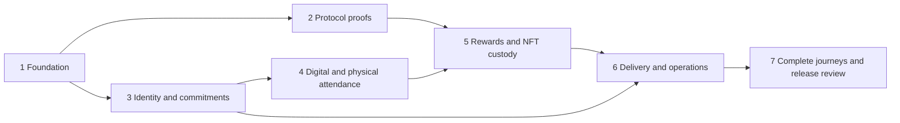

# Showup plan

This is the single task tracker. Requirements live in [the PRD](prd.md);
maturity and the next action live in [current state](../CURRENT_STATE.md).
Owner approval on November 2, 2026 authorizes F1–F4, followed by only the I3
event-draft interface/validation and isolated development persistence subset.
All work stays local and unpublished. Other tasks remain proposed and unapproved.

| Approved checkpoint | Status | Evidence |
| --- | --- | --- |
| F1 | Complete | `eb42d64`: exact manifest/lockfile, seven-day gate, blocked lifecycle scripts; zero high/critical and zero runtime advisories. Format/lint/types, configuration unit test and shell production build pass. [Setup](setup.md). |
| F2 | Complete | Digest-pinned Node/PostgreSQL images; health/migration-ordered Compose starts, restarts, stops and resumes on M4. Published ports verified as loopback; startup rejects unsupported configuration. This checkpoint's commit plus [verification](verification.md) identify evidence. |
| F3 | Complete | Seven real PostgreSQL integration checks pass: concurrent/checksummed migrations, DDL rollback, SIGKILL before/after writer commit and worker effects, atomic dispatch rollback, concurrent logical effect deduplication and bounded dead-letter retries. [Verification](verification.md). |
| F4 | Complete | Format/lint/types, unit/integration, Chromium production smoke and Docker build pass; frozen-install CI defined with pinned actions and no provider secrets. CI has not run remotely because publication is prohibited. [Setup](setup.md). |
| I3 subset | NOW | Draft UI, shared validation, transactional PostgreSQL persistence, private browser workspaces and revision/replay checks implemented. Seven unit, twelve integration and eight browser tests pass, including actual Compose persistence/restart. [Review guide](verification.md), [isolation decision](adr/0003-local-draft-workspace.md). Final clean-checkout reproduction/receipt is next; I3 authentication, funding, immutable publication and integrations remain incomplete. |

The descriptions below retain planning history. Their earlier approval warnings
apply to that historical checkpoint; the bounded approval above supersedes them
only for F1–F4 and the named I3 subset. SCOPE-01 is partially resolved by that
approval, not completion of all product scoping or the full roadmap.

| ID | Status | Outcome and acceptance | Evidence |
| --- | --- | --- | --- |
| REPO-01 | Complete | Private `gueysito/show-up` repository; navigable front door; product-only requirements; active commit template and checks; no application implementation. | [README](../README.md), [agent instructions](../AGENTS.md), [standards](../.standards/README.md). Initial commit verification covers links, scope, baseline checks, and rejection of an incomplete commit message. |
| SCOPE-01 | NOW | Discuss audience, full event loop, proposed economic defaults, integration gates, and evidence needed to assess product-market fit. Completion requires the owner's recorded decisions before an implementation plan is approved. | [Technical scope](technical-scope.md) records platform evidence, confirmed pilot/streak/network choices, and framework/partner recommendations. Base is the default EVM route; Ethereum remains required. Recommendations are not implementation approval. |

SCOPE-01 evidence: the [framework compatibility review](technical-scope.md#framework-compatibility-review)
confirms framework-independent wallet paths and documents the Better Auth /
Telegram email mismatch in both frameworks. [ADR-0001](adr/0001-application-and-authentication.md)
records accepted Next.js, Node.js, openid-client, and PostgreSQL-backed sessions.
Session/linking implementation and live verification remain build tasks.
October 31 checkpoint: owner-approved interview decisions are reconciled in
[PRD sections 7–16](prd.md) and the
[remaining decision register](technical-scope.md#decisions-needed-before-a-build-ready-plan).
Docker Compose/Railway and invitation-only mainnet are accepted. Economics,
attendance, NFT prizes, claims/redraws, and reduced testing deposits are recorded.
Latest checkpoint also records capped fee deductions, three same-request draw
attempts within a provisional two-minute window, all-funds-return aborts, locked
capacity/material terms, and host/attendee invitation rules. SCOPE-01 remains
open for owner review of this detailed plan and subsequent implementation approval.
Custody observation trust is settled; technical proof and later funding remain gates.
The [consolidated recommendation](technical-scope.md#consolidated-technical-recommendation)
groups the remaining technical choices and distinguishes proposals from accepted policy.
Verification: repository standards, whitespace, local Markdown links, and
product-only content checks; no application or security validation is claimed.

REPO-01 is the repository setup checkpoint. SCOPE-01 authorizes discussion only.
Do not expand the roadmap or change acceptance criteria without owner approval.

November 1 wallet-preparation checkpoint: owner-generated keys backed up in
1Password (owner reported); local file permissions verified; public addresses
and faucet status recorded in [development wallets](development-wallets.md).
Latest read-only checks at 18:10 UTC: NEAR 10 test NEAR; Ethereum Sepolia
~0.007 ETH + 20 USDC; Base Sepolia 0.003 ETH + 20 USDC; Solana devnet 5 SOL.
Network identifiers and NEAR public-key association checked. Proof-of-work tool
was not installed and is no longer needed for initial funding. This authorizes no
application implementation, mainnet spending or unattended work.

November 1 ownership-test preparation checkpoint: public network identities and
the same balances reconfirmed at 18:25 UTC. A temporary Rabby ownership page in
owner-approved local scratch passed reference-vector and HTTP boundary checks;
see [wallet guide](development-wallets.md#ownership-test-preparation).
Project-account connection passed; the network gate blocked message preparation
on Ethereum Sepolia. After the owner added Base Sepolia and the site selected it,
the owner-signed challenge verified at 18:33:09 UTC. Wrong nonce/domain, modified
text, wrong key, expiry and replay checks passed. The owner-signed Base Sepolia
native self-transfer succeeded in block 53184329; two RPC receipts matched and
the 210000000090-wei fee exactly reconciled the balance change. The owner-signed
0.01-USDC self-transfer also passed in block 53185675: exact Transfer event,
unchanged 20-USDC balance and 374470000090-wei fee reconciliation, with matching
receipts from both RPCs. Finality for both passed on November 2 at 09:36 UTC:
two providers reported finalized head 53445467 and unchanged canonical receipts.
Phantom ownership passed at 09:37:58 UTC with negative nonce/domain/text/address/key,
expiry and replay checks; devnet identity and 5-SOL finalized balance reconfirmed.
Solana transfer subsequently finalized, but its fee-limit check failed: Phantom
added priority fees, charging 80000 lamports against a 10000-lamport review ceiling.
Balance reconciliation passed; resolve wallet fee changes before further signing.
Ethereum Sepolia native self-transfer passed execution and balance reconciliation
with a 120000000000-wei fee; finality remains pending. Solana fee-control retest
preparation uses explicit zero priority fee and checks signed bytes before a
separate owner-operated broadcast. That retest finalized with unchanged signed
bytes and a 5000-lamport fee; fee control and balance reconciliation passed.
NEAR owner-operated ownership signing passed at 10:09:32 UTC, including negative
challenge checks and independent signature verification. A 0.0001-NEAR self-transfer
finalized with matching receipts from NEAR RPC and FastNear; the exact
44636512500000000000-yoctoNEAR fee reconciled the balance and stayed below the
review ceiling. No further initial wallet signatures are needed. Ethereum's
canonical successful receipt has not yet reached finalized status, so
read-only finality confirmation is the remaining wallet check. See the wallet guide for evidence
and limits; no application implementation is claimed.

## Implementation plan for approval

This expands the existing seven proposed outcomes into executable milestones;
it does not create a second tracker or authorize implementation/deployment.
Owner accepted contract-enforced custody. [ADR-0002](adr/0002-nft-custody.md)
records the accepted contract-control and platform-attested observation model.
Planning work is complete for this checkpoint; SCOPE-01 remains NOW until review.

Effort ranges are engineering workdays (roughly six focused hours), not elapsed
AI execution time or a delivery promise. They include implementation and focused
verification, exclude external waiting/audits and use the accepted attested
observation model. Full cryptographic cross-chain proofs require a
new estimate. Confidence is low until the early protocol experiments conclude.

| Existing outcome | Work and dependency | Effort | Completion evidence |
| --- | --- | --- | --- |
| 1: Foundation | Pin stable versions with supply-chain checks; Next.js/web, worker, PostgreSQL, migrations, outbox, Docker Compose, CI format/lint/typecheck/tests; fail-closed configuration. No external funding required. | 2–3 days | Clean clone starts locally; migrations and job recovery work; no visitor simulation or secrets in bundles. |
| 2: Protocol proofs | After minimal foundation, prove G1 token attribution/destination binding, G2 same-request recovery, and ADR-0002 signed payload/intent enforcement. NEAR sandbox first; EVM/Solana engineering networks next. Mainnet Intents portion waits for separately approved funds. | 4–7 days | Round-trip trace, independent draw verification, mutated-field/replay/race rejection, custody transfer and return on each family. Pause dependent integration if provider cannot meet invariants. |
| 3: Identity and commitments | After foundation; use the accepted observer model; identity work can proceed alongside protocol proofs. OIDC sessions/linking, nonce-based wallet binding, host/attendee invitations, event rules, fee caps, capacity reservations, commit/release/late-return accounting. | 4–6 days | G5, PRIV-01, INVITE-01/02, CAPACITY-01, MONEY-01–06 and cancellation authorization. No real transfers until G1 passes. |
| 4: Both attendance modes | After identity/commitments. Three-minute fresh code words, bound Telegram prompt, staff QR scan, exact windows, evidence outage handling; begin actual-phone tests here. | 3–4 days | ATT-01–03, LIVE-01/02; phone camera, app return and audio checks; no manual overrides. |
| 5: Rewards and prizes | After attendance and protocol proofs. Quizzes, 1.25× streak, three presets, bound draw rounds, acceptance/typed decline, 30-day deadline, native NEAR NFT custody and external signing adapters. | 5–8 days | QUIZ/STREAK/DRAW/CLAIM/NFT matrix; freeze/abort/expiry/retry tests; contributor exclusions; two-minute target measured. |
| 6: Delivery and operations | After money and reward engines. Idempotent routes, fee deduction/net receipts, NFT finality, recovery queues, reports, all four network qualification. Design backup/restore, caps and shutdown continuity before hosting. | 3–5 days | Destination receipts and reconciled reports; no double payment or stranded unknown liabilities; restore/restart recovers pending work. |
| 7: Integration and release review | After all prior outcomes. Adversarial auth/data/money tests, 100-seat concurrency/load, complete digital/physical journeys, clean-clone reproduction and recovery rehearsal. Mainnet activation only with explicit budget/deployment approval. | 3–5 days | G1–G6 where applicable, complete acceptance matrix, security findings resolved for restricted exposure; optional G4 absence honestly disclosed. |

Total planning range: **24–38 engineering workdays**, before external waiting or
independent audit. Some foundation/identity work can overlap protocol investigation;
do not subtract overlap before assigning actual capacity. Four-network NFT custody
and cross-chain authorization dominate uncertainty. No network or attendance mode
is removed to fit a calendar. If a milestone exceeds twice its estimate, stop and
reforecast with evidence, rather than silently reducing acceptance.

### Verification commands to establish in outcome 1

Use the chosen package manager's locked install and exact scripts for `format:check`,
`lint`, `typecheck`, `test:unit`, `test:integration`, `test:e2e`, and `build`; Rust
contract checks use `cargo fmt --check`, `cargo clippy`, and `cargo test` plus the
selected sandbox runner. These are planned commands, not currently available.
Keep existing repository hooks active. Separate tests requiring external providers
or funds from offline CI so CI cannot unexpectedly spend real money.

### Security and stop conditions

Check server authorization, user-to-user ID swaps, admin access, rate limits,
error redaction, input/query handling, CSRF/CORS, server secret isolation, dependency
advisories and production debug defaults. Avoid uploads initially; remote NFT
metadata fetching needs SSRF/size/time limits. Money tests cover conservation,
callback failure, replay, fee cap enforcement, destination substitution and every
claim/timeout/return race. Test deterministic transitions, not merely mocks.

A provider failure cannot be patched with a platform hot wallet, unrestricted
signing or new draw request. Native-chain and cross-chain proofs remain separate.
External attestation is accepted for restricted, inexpensive allowlisted assets; its implementation must pass verification before publication. No production
security claims follow from documentation or a passing unit test alone.

### What requires the owner, and when

- Before implementation: approve this plan. Routine package/version selection and
  test implementation belong to engineering; return only for material scope/risk changes.
- Before mainnet experiments: approve public wallet addresses, exact route quotes,
  total and per-attempt caps, fee/service budgets. No secret values in planning docs.
- Before hosting: approve deployment destination, operating budget, recovery and
  security evidence. Preserve claim access and accepted liabilities after shutdown.

## How to execute this plan

All tasks below are **planned, not started**. Their IDs decompose the seven existing
milestones within this sole tracker; they are not new product stages. The PRD is
requirements authority. ADR-0001 governs authentication; ADR-0002 governs custody.
Each checkpoint updates this plan with its commit, checks and actual limits.

Implementation requires a new explicit instruction. Calendar dates do not activate
permission. Preparing this document does not authorize scaffolding, dependencies,
contract deployments, wallet use, account purchases or transactions. Keep the repo
private unless separately authorized. Ordinary technical choices are engineering
responsibility; escalate only material changes to cost, scope, behavior or trust.

### Dependency map

Local schemas, UI and deterministic rules can progress while external proofs await
access. Passing mocks does not pass an integration gate. Start G1/G2 investigation
early enough to change an adapter before building all dependent screens. Both
attendance modes and all four networks remain release requirements.

### Planned code boundaries

These directories are proposed destinations, not files to create during planning.

| Boundary | Proposed location | Responsibility |
| --- | --- | --- |
| Web | `src/app/`, `src/components/` | Pages, accessible controls, server endpoints; never expose signing credentials |
| Server | `src/server/auth/`, `events/`, `invitations/`, `db/` | Sessions, role checks, private records, transactions and migrations |
| Domain | `src/domain/` | Pure timing, eligibility and integer accounting rules, shared test vectors |
| Worker | `src/worker/` | Durable jobs, bounded retries, reconciliation and notifications |
| Adapters | `src/integrations/` | 1Click, wallets, randomness, NFT observers and broadcasters |
| NEAR | `contracts/showup/`, `contracts/custody/` | Enforced money/claim policy and restricted external signing; separate credentials |
| Verification | `tests/unit/`, `integration/`, `e2e/`, contract tests | Offline rules, actual database/sandbox, browser and provider evidence |
| Operations | `docs/setup.md`, `docs/operations.md` | Reproducible setup, configuration names, backup/restore and incident recovery |

Do not add a generic microservice framework or separate datastore for every feature.
Store integer atomic amounts and serialize large integers as strings. Keep versioned
rules and contract schemas explicit; frontend calculations never authorize payouts.

## Detailed work packages

Effort is allocated by the milestone ranges above, not added on top. Each row is a
reviewable work package, potentially several small commits. Check dependencies at
its start and record actual effort at its end. Source IDs link to official references
below; prescriptions not explicitly stated by those sources are Showup design choices.

### 1. Reproducible foundation

Prerequisite: implementation approval. Owner: implementing engineer.

| Task | Output and execution details | Acceptance / failure check |
| --- | --- | --- |
| F1 Runtime baseline | Select one package manager, supported Node LTS, stable framework/tool versions; record exact pins and seven-day release-age gate. Resolve/audit the dependency graph before executing installed code; disable unreviewed lifecycle scripts. [DOC1] | Lockfile checked in; no high advisories without reviewed resolution; no scaffold overwrites AGENTS.md or standards. |
| F2 Local topology | Next.js web, separate worker, PostgreSQL, explicit migrations and typed configuration. Compose waits for database health and completed migrations. Bind local services to loopback; database stays private. [DOC2] | Clean checkout starts, restarts and shuts down predictably; absent required configuration fails without leaking values. |
| F3 Durable jobs | Implement transactional outbox and pg-boss consumption; use stable operation IDs, bounded retry/backoff and dead-job visibility. [DOC3] | Kill worker before/after DB commit; committed work is recoverable and rollback creates no orphan job. Multiple workers do not duplicate a logical action. |
| F4 Checks and setup | Formatting, lint, typecheck, unit/integration tests, production build and frozen-install CI. Document commands and expected output; identify which commands use external services. | Existing hooks still pass. CI lacks mainnet secrets and cannot spend. Fresh clone follows setup without undocumented global tools. |

Exit: runnable local infrastructure and evidence of migration/job recovery. Do not
present the shell as a working payments product. Exact application commands are
introduced here and then become required for subsequent checkpoints.

### 2. Early protocol proofs

Prerequisite: F1/F2 and approved external access when needed. No fees are spent by
default. Use real engineering test networks for signing and NFTs; Intents needs a
separate explicitly approved mainnet budget. [DOC4–DOC7]

| Task | Output and execution details | Acceptance / failure check |
| --- | --- | --- |
| P1 Network manifest | Resolve canonical settlement token, decimals, chain IDs, collection/program allowlists, explorers, signer domains, provider versions and finality policy. | Reject wrong chain/token and missing configuration. Do not infer identity from ticker symbols. Each approved artifact records source and revision. |
| P2 Intents attribution | Implement quote/status adapter and contract receiver with test harness. Bind event, rules, participant credential, amount, expiry and authorized destinations. | Actual Base-to-NEAR escrow receipt then authorized return, followed by NEAR/Solana/Ethereum cases. Test duplicate/late/short/excess input. Provider success alone cannot enroll. |
| P3 Draw request recovery | Bind request ID, key, seed, round and snapshot; reproduce verification independently. Recover original execution at provisional 0/15/45-second offsets inside two minutes. | Different request or proof rejected; timeout and result cannot both allocate. Measure provider latency. If same-request recovery is unsupported, report evidence before changing policy. |
| P4 Custody signing | Build NEAR-native receipt prototype and typed EVM/Solana transaction builders under ADR-0002; lock recipient intent before signature request. | Every mutable field has a hostile test; cannot sign arbitrary calls or an opposite return. Demonstrate delivery and failed-transfer recovery on engineering networks. |
| P5 Observer evidence | Separate observer key, two independent RPC providers, exact asset/state/block binding and finalized-state policy. Low-value allowlisted assets only. | Conflicting, stale, wrong-event or insufficiently final observations pause publication. A false delivery report cannot change the authorized recipient. Record residual observer trust. |

Exit: evidence for architecture viability, not blanket security approval. Dependency
failure blocks only affected integrations; never silently replace custody with a hot
wallet or use random browser output. Preserve actual chain traces without identities.

### 3. Identity, invitations and commitments

Prerequisite: F1–F4. P2 blocks real-money enrollment, not offline implementation.

| Task | Output and execution details | Acceptance / failure check |
| --- | --- | --- |
| I1 Identity/session | Telegram and Google OIDC using openid-client; verified issuer/subject, signatures, state/nonce/PKCE, secure opaque revocable sessions. [DOC8] | Telegram without email works; callback replay, issuer confusion, expired sessions and unsafe redirects fail. No implicit email-based linking. |
| I2 Roles and invitations | Admin-only host invitations, 15-day unused expiry. Host/admin event invitations expire at registration close. Atomic redemption bound to account; separate message consent. | ID swaps, simultaneous redemption, revoked token, cross-event reuse and self-promotion fail. Redeemed access survives invitation expiry. |
| I3 Event draft/publish | Mode, capacity up to 100, timing, reward preset, optional questions/NFT, fee and cancellation preview; funding prerequisites and immutable rule hash. | Only harmless copy edits after publication. Duplication creates fresh draft with no funds, attendees or invitations transferred. |
| I4 Wallet and commitment | Domain-bound signature challenge; authorized destinations and fee caps. Five-minute reservation clipped at close; escrow controls final enrollment. | Wallet replay/changed destination fail; concurrent last-seat race cannot overbook. Expired reservation can enroll only with valid authorization, open registration and space. |
| I5 Recovery and privacy | Automatic late/full/duplicate return, user release, own-data export/deletion workflow and role-filtered reports. [DOC9] | One refund per liability; unresolved funds survive deletion request. Never expose identity-wallet mappings in logs/on-chain. Closed page remains accessible without enabling deposits. |

Exit: G5 and invitation/capacity/money checks pass. Request credentials only when
live provider callbacks are needed; name required keys, never ask to paste secrets
into chat or store them in the repo.

### 4. Both attendance modes

Prerequisite: identity and committed-registration engine; digital and physical
experiences use the same evidence ledger.

| Task | Output and execution details | Acceptance / failure check |
| --- | --- | --- |
| A1 Digital codes | Host-selected word/phrase, case/space normalization, fresh per activation, three minutes clipped at cutoff, bounded attempts. | Old word cannot work in a new window; repeated transport delivery yields one check-in. Web and bot share event-bound context. |
| A2 Physical QR | Personal opaque expiring credential; authenticated assigned staff scan and confirm actual presence. No manual override. | Wrong event, replay, expired credential, unassigned validator or unfunded attendee rejected. Pending offline work never appears confirmed. |
| A3 Time/outage engine | On-time through start+10m, final cutoff end−15m, evidence reconciliation, normal close and fail-neutral outage/abort. | Boundary tests include equality and delayed delivery. All abort assets return; no reward concentration. Host claim alone cannot manufacture an outage. |
| A4 Mobile and bot | Ordinary optional bot, event deep links, silent accessible controls, keyboard/screen-reader labels, phone wallet return and audio continuity. | iOS/Android actual-device record; muted deposit control has explicit closed text. UI cannot bypass server/contract windows. |

Exit: ATT-01–03 and LIVE checks for both modes, not a digital-only pilot. Late
attendance preserves refund/equal/streak but excludes all draw entries.

### 5. Rewards, draw and NFT claims

Prerequisite: attendance rules and P3–P5. Use PRD accounting examples as independent
test vectors, including empty and single-participant sets.

| Task | Output and execution details | Acceptance / failure check |
| --- | --- | --- |
| R1 Accounting | Gross principal, E/D sponsor pools, forfeitures, deterministic rounding; equal-only/draw-only/hybrid; host/staff/sponsor/NFT contributor exclusions. | Exact conservation over varying participant counts; no host receives forfeitures; no eligible draw returns D/NFT. |
| R2 Optional participation | Zero to two quizzes, default 90s configurable 60–180s; one answer per identity/question. Daily 1.25× at day five, fixed timezone and protected days. | Missing quiz never threatens refund; quarter-entry integer math; DST, duplicate days and delayed evidence cannot inflate streaks. |
| R3 Draw and claims | Frozen snapshot, weighted selection, one common 30-day deadline, combined acceptance, typed DECLINE and removal from future rounds. | Simultaneous accept/decline resolves once; silence never redraws; explicit declines do not restart deadline; accepted delivery debt never expires. |
| R4 NFT custody | NEAR receiver and external signing/observer adapters; exact asset and contributor reserve required before publication. Verify receiving wallet before NFT draw entry. | Four-network evidence; failed/replayed transfer cannot create another beneficiary. Frozen/delegated/unapproved assets fail eligibility checks. |
| R5 Recovery UI | Selected, accepted, declining, redrawing, timeout-return, delivery-pending and delivered states; separate money/NFT receipts. | UI matches canonical state after refresh. No premature success or independent partial acceptance. |

Exit: complete QUIZ/STREAK/DRAW/CLAIM/NFT acceptance. The two-minute recovery target
is not a guarantee of instantaneous external settlement.

### 6. Delivery, reports and operational preparation

Prerequisite: canonical liabilities/claim decisions. Hosting and funds still need
separate approval; write configuration/runbooks before activating paid services.

| Task | Output and execution details | Acceptance / failure check |
| --- | --- | --- |
| D1 Payment reconciliation | Persist route IDs, authorized destinations, transaction evidence, uncertain attempts and bounded retries. Itemize gross, actual fee, net. | Cap excess requests fresh consent. Below-minimum/net-zero payout remains recoverable. Never send again while old route can succeed. |
| D2 Network qualification | Execute the same deposit/refund/cancellation/return cases on NEAR, Base, Solana and Ethereum; contributor-funded NFT delivery on each. | Each manifest entry links evidence; an unpassed route stays disabled and prevents full-scope release rather than disappearing from requirements. |
| D3 Host reports | Counts, costs, funding sources, forfeitures, returns, net payouts and outstanding debt derived from ledger/evidence. | REPORT-01 matches actual records; test zero attendance and delayed finality. No claimed listening duration or attendance lift. |
| D4 Operations | Railway web/worker/Postgres, private networking, alerts, backup/restore, redaction, resource budgets, migrations and rollback. [DOC10] | Restore rehearsal and worker restart preserve obligations. Health means more than HTTP uptime; alert on stalled funds. |
| D5 Retirement | Inventory unpaid/accepted prizes, 30-day claim windows and refund liabilities before shutdown. Publish recovery access and operator responsibilities. | No service teardown strands accepted funds. Define how reconciler/claim access continues; expiration is not permission to seize owed assets. |

### 7. End-to-end verification and release review

Prerequisite: all earlier exits, approved exposure configuration and funds for real
integration evidence. Developer convenience must not weaken funded deployment rules.

| Task | Output and execution details | Acceptance / failure check |
| --- | --- | --- |
| V1 Browser journeys | Independent browser contexts, user-visible locators/assertions, trace failures, no arbitrary sleeps. [DOC11] | New host invitation through funded event; new attendee through check-in/refund/prize; digital and physical cases. |
| V2 Adversarial review | Role isolation, auth replay, XSS/SSRF metadata handling, rate limits, secret/CORS/CSRF review, contract upgrades and signing-field mutations. | Findings have severity, reachable path, fix and rerun evidence. Security-sensitive failures block affected exposure. |
| V3 Load and recovery | 100-seat concurrency, worker crashes, provider outages, database restore, dropped/replaced transfers, proof timeout/late callback races. | No overbooking, duplicate payment, competing NFT signatures or false confirmations; record measured latency/gas/cost. |
| V4 Clean-clone reproduction | Follow setup without author intervention, inspect containers and default network flags, run production build and appropriate checks. | Another operator reproduces the documented outcome; no hidden keys or fake transaction history. |
| V5 Release receipt | Record commit/build hashes, manifests, checks, unresolved limitations, actual network evidence and rollback/recovery procedure. | Owner approves target and budget before deployment; verify live expected content after activation. No blanket readiness claim from a Git push. |

## Evidence, configuration and external prerequisites

Each task completion record in this tracker must identify: commit; command/scenario;
expected versus observed result; environment and version; evidence location; any
excluded checks; next dependency. Do not create parallel status spreadsheets or
session logs. Public chain evidence must not contain a social identity directory.

| Prerequisite | Needed by | Handling |
| --- | --- | --- |
| Google/Telegram registration and callback URLs | I1 live verification | Register only when authorized; local callback capability is verified against provider rules. Offline tests do not prove live login. |
| Specific NEAR wallet and supported phone/browser versions | I4, A4 | Choose a wallet with documented signing support; verify compatible return flow. |
| Two independent external RPC providers per observed chain | P5 | Validate independence, finality, rate limits and budget; disagreeing sources fail closed. |
| Exact NFT collections/assets | P4/R4 | Low-value allowlisted assets, no undisclosed administrator/delegate power to move escrowed prizes. |
| Mainnet wallets and all-in caps | P2/D2 | Public addresses only in planning; caps include provider/signing fees, gas, storage, retries and reserves. No automatic replenishment. |
| Railway account, domain, region, backups and budget | D4/V5 | Configure only after approval; distinguish platform spend from recoverable principal and reward funding. |

### Verification commands and isolation

Outcome 1 establishes one package manager and real scripts before documenting them
as runnable. Required script families: formatting, lint, typecheck, unit tests,
database integration, browser tests and production build. Contract verification uses
format/lint/unit plus NEAR sandbox tests, including asynchronous callback failures.
Commands consuming external services must be visibly separate and fail without an
explicit environment selection; CI must never default to mainnet.

Mocks and synthetic clocks are engineering fixtures only. They cannot appear as
live payment evidence in the visitor-facing product. Validate database concurrency
against PostgreSQL, contract transitions against the sandbox, actual provider
responses in integration tests, and actual wallet/audio behavior on phones. [DOC4, DOC11]

### First implementation session, after explicit approval

1. Read current state, this tracker and both ADRs; fetch and report remote overlap.
2. Revalidate selected versions/advisories, then execute F1 without floating scaffold
   commands or unreviewed install scripts. Preserve the existing front door/hooks.
3. Execute F2–F4 in small checkpoints. Produce a local setup guide with observable
   startup, migration, queue-recovery and shutdown results.
4. Start P1–P5 with engineering fixtures; continue I1/I2 where no external access is
   needed. Identify the exact live prerequisites, not a generic request for all keys.
5. Record actual effort and revise the remaining forecast after protocol evidence.

The 24–38-day range is an initial effort model, not a promised calendar. Do not
compress it merely because the desired start is imminent. At 2× a package/milestone
forecast, stop and explain the evidence and options; changing required scope needs
owner approval. Long external waits do not justify fake integration results.

## Official reference index

Reviewed for planning on October 31, 2026. Follow the selected stable version at
implementation time; a documentation example is not a dependency pin. These sources
justify mechanisms, not proof that Showup already implements them.

| ID | Official documentation | Application |
| --- | --- | --- |
| DOC1 | [Next.js installation](https://nextjs.org/docs/app/getting-started/installation), [self-hosting](https://nextjs.org/docs/app/guides/self-hosting), [Node release policy](https://nodejs.org/en/about/previous-releases) | Supported runtime, App Router setup and production boundary |
| DOC2 | [Docker Compose startup order](https://docs.docker.com/compose/how-tos/startup-order/) | Health and migration dependencies; running is not necessarily ready |
| DOC3 | [pg-boss upstream](https://github.com/timgit/pg-boss), [Drizzle PostgreSQL](https://orm.drizzle.team/docs/get-started-postgresql) | Queue and database integration; external exactly-once behavior remains application work |
| DOC4 | [NEAR integration testing](https://docs.near.org/smart-contracts/testing/integration-test), [callbacks](https://docs.near.org/smart-contracts/security/callbacks) | Controlled-time sandbox and asynchronous recovery tests |
| DOC5 | [1Click quickstart](https://docs.near-intents.org/integration/distribution-channels/1click-api/quickstart/introduction), [quote API](https://docs.near-intents.org/api-reference/oneclick/request-a-swap-quote) | Actual routes and exact-output constraints; no Intents testnet |
| DOC6 | [OutLayer randomness](https://app.outlayer.ai/docs/vrf) | DOCequest-bound proof; same input differs from merely reusing a seed |
| DOC7 | [NEAR Chain Signatures](https://docs.near.org/chain-abstraction/chain-signatures/implementation), [NEP-171](https://github.com/near/NEPs/blob/master/neps/nep-0171.md), [ERC-721](https://docs.openzeppelin.com/contracts/5.x/api/token/erc721), [Metaplex Core](https://www.metaplex.com/docs/smart-contracts/core) | Custody interfaces, encodings and asset restrictions; external observations remain attested |
| DOC8 | [openid-client](https://github.com/panva/openid-client), [Telegram OIDC](https://core.telegram.org/bots/telegram-login), [Google OIDC](https://developers.google.com/identity/openid-connect/openid-connect) | Provider identity, signature validation and callback requirements; sessions remain application-owned |
| DOC9 | [PostgreSQL locking](https://www.postgresql.org/docs/current/explicit-locking.html) | Atomic reservation/redemption allocation and race/deadlock handling |
| DOC10 | [Railway services](https://docs.railway.com/guides/services), [PostgreSQL](https://docs.railway.com/guides/postgresql), [cost control](https://docs.railway.com/pricing/cost-control) | Later operations planning; backup/restore behavior must be checked against chosen service configuration |
| DOC11 | [Playwright best practices](https://playwright.dev/docs/best-practices) | Isolated user-visible tests and resilient locators |

## Initial wallet test sequence

This is preparation within P1/I4, not approval for application implementation or
mainnet work. Three test groups, in order:

1. **Network, account and funds:** public RPC reads only. Completed November 1 at
   18:25 UTC; see the wallet guide for amounts and identities. Recheck before signing.
2. **Proof of signing control:** prepare one domain-bound, expiring nonce challenge
   per wallet family; owner signs through isolated Rabby/Phantom or a deliberately
   configured local NEAR signer. Verify signature against the recorded public
   identity. Wrong nonce/domain, modified text, wrong key and replay must fail.
   No token approvals, transactions or key export to chat. EVM passed November 1
   at 18:33:09 UTC through Rabby on Base Sepolia. Solana passed November 2 at
   09:37:58 UTC through Phantom; NEAR passed November 2 at 10:09:32 UTC through
   the owner-operated local signer.
3. **Small transfer and receipt:** prepare a reviewed testnet-only self-transfer
   (native asset) and a small EVM USDC self-transfer, explicitly showing network,
   recipient, amount, estimated fee and before/after balance. Owner approves each
   wallet prompt; local automated signing needs separate authorization. Testnet
   self-transfer proves signing, execution and receipt accounting, not escrow,
   independent recipient delivery or cross-chain routing. Base Sepolia native
   inclusion and fee reconciliation passed November 1 at 18:46 UTC; the USDC
   self-transfer event and balances passed at 18:50 UTC. Finality for both passed
   November 2 at 09:36 UTC with two RPC providers. Solana finalized but exceeded
   its fee review ceiling; a controlled fee retest finalized within the ceiling. Ethereum Sepolia
   native execution and accounting passed; Ethereum finality remains pending.
   NEAR native transfer finalized with two-provider receipt agreement and exact
   fee reconciliation. No further signatures are required for this initial sequence.

Start with the first wallet family and record its result before repeating; do not
request multiple blind signatures. Derive exact transfer amounts and fee limits
at preparation time. No funds leave the project address during self-transfer,
but native gas is consumed. Never substitute mainnet when a testnet is unavailable.
