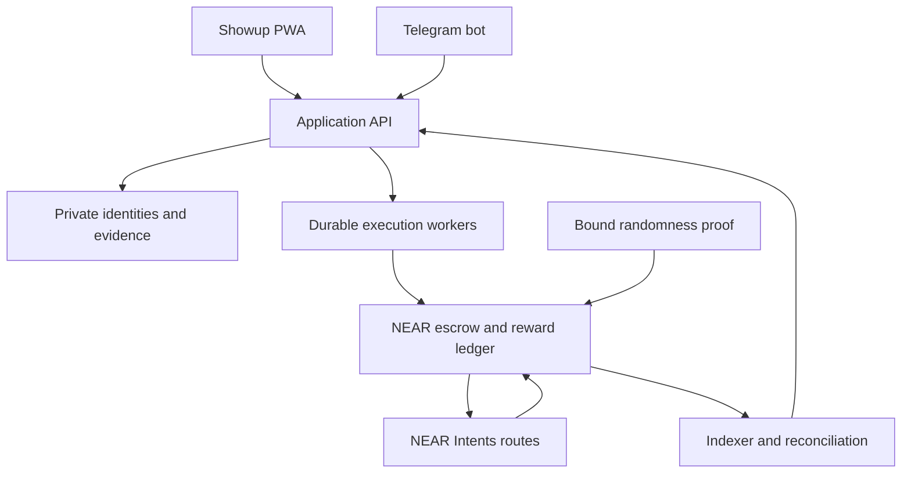

# Showup
## Product requirements

**Product baseline:** 1.0 · **Source prepared:** October 21, 2026 · **Product edition:** October 29, 2026

**Status:** Proposed product scope. No application, contracts, integrations, or pilot results exist in this repository yet.

This product edition preserves the owner's supplied requirements and technical references.
Defaults and the reference stack remain proposals for discussion, not authorization to implement
or evidence of working integrations. The current authorized work is repository setup and product scoping.
The owner has not yet approved an implementation plan. Source citations retain their original
identifiers; external technical claims must be revalidated when implementation begins.

The [technical scope](technical-scope.md) records current documentation findings
and open implementation choices. Owner confirmation on October 29, 2026: both
digital and physical attendance modes must be ready before the first real pilot;
daily streaks unlock a modest, non-escalating boost after five consecutive days
and reset after a missed, unprotected day. The exact 1.5x factor below remains a
proposed numeric default.

Owner-confirmed network direction: Base is the default EVM route and Ethereum
mainnet must also be available. Wallet targets include Phantom, Rabby, and a
selected NEAR wallet. Prefer low cost and fast delivery using current route
quotes, without changing the user's authorized destination. Required routes
must pass acceptance tests before use; removing one requires an explicit scope
decision rather than treating it as an unplanned extra.

> Showup turns a promise to attend into a refundable commitment.

## 1. The product in one page

Showup turns an RSVP into a funded commitment. An attendee places a refundable stablecoin deposit, checks in to an event, and receives the deposit back. A sponsor funds rewards; valid no-show forfeitures add a bonus. Optional quizzes and a daily attendance streak improve the attendee’s chances in a publicly verifiable draw. The host receives a report showing commitments, check-ins, no-shows, rewards, and cost per verified check-in.

The first real pilot runs alongside an X Space. A physical-event mode uses a staff-validated personal QR code. Both use the same money rules and NEAR escrow.

The client is a responsive website with optional PWA installation. An ordinary Telegram bot supplies reminders, check-in prompts, quiz buttons, text answers, and receipts. Telegram is optional. Showup does not host or replace the event’s audio.

Attendees may fund through tested routes on NEAR, Solana, Base, and Ethereum. NEAR Intents handles supported cross-chain conversion and routing; Showup’s NEAR contract governs the actual commitment and reward allocation. The event’s accounting asset is USDC on NEAR, with the precise accepted token contract pinned before deployment.

### Five substantial pieces

| Piece | What the user experiences | What the implementation proves |
| --- | --- | --- |
| Funded commitment | Clear rules, wallet choice, deposit receipt | A real deposit reaches the correct event escrow |
| Attendance | Live code online or personal QR at a venue | Evidence is bound to an eligible attendee and event |
| Participation | Short quizzes, entry feedback, daily streak | Optional actions add upside without threatening principal |
| Draw and settlement | A visible winner, refunds, rewards, transaction receipts | Frozen rules and entries determine money outcomes |
| Host results | A concise attendance and spending report | Reported outcomes reconcile to actual records |

**Attendee promise:** show up, recover your commitment, earn rewards, build your streak.
**Host promise:** fund a reason to attend, recognize participation, and see what the outcome cost.

> Attendees fund the commitment. Hosts and sponsors fund the excitement.

## 2. How to read and implement this specification

Sections 1–5 explain the product and journey. Sections 6–19 define behavior and architecture. Sections 20–21 define validation gates, acceptance tests, and product completion.

- **Requirement / MUST:** necessary behavior for this release.
- **Default:** a concrete implementation choice selected here where discussion did not settle the exact number or boundary. Review it with the owner before implementation; record any accepted change before publication of affected events.
- **Integration gate:** a technical capability that must be demonstrated before the dependent route is enabled. A documentation claim is not a passed gate.

Defaults include the 1.5× streak multiplier, day-five activation timing, late-arrival reward split, event capacity, and operational timeouts. They are specification decisions, not assertions that every detail was previously approved individually.

An event’s published economics cannot be changed by editing this document. Changes apply to newly published events only. Do not silently remove a promised feature: obtain approval for scope changes and disclose the actual delivered scope in release notes.

## 3. Audience, goals, and boundaries

### 3.1 Audience and pilot

The initial host is Biggie, using established X Spaces relationships. Target attendees already understand crypto wallets but should not need to learn NEAR to participate. Follow-on hosts should be able to operate the same interface without developer intervention for routine event tasks.

The physical demonstration is a small room or meetup with an authorized validator scanning attendee QR codes. Label a staged demonstration as staged; do not represent it as a proven commercial venue deployment.

### 3.2 Product goals

1. Make the difference between refundable principal, reward money, and fees immediately understandable.
2. Complete the commitment-to-payout loop with real contract state and independently checkable receipts.
3. Keep audio playing and make participation take seconds.
4. Let a quiet attendee earn the same base participation benefits as a speaker.
5. Make the host’s report useful enough to inform running a second event.
6. Demonstrate NEAR’s value through cross-chain access and enforceable settlement.

### 3.3 Scope boundary

This release includes one event currency, one sponsor funding account per event, a maximum of two quizzes, one final draw, equal-split/draw/hybrid reward presets, daily streak progress, simple series attendance badges, one Telegram bot, and essential host controls.

Audio remains on the event’s existing platform. The Telegram integration is an ordinary bot, with no Mini App component or automated bot provisioning. Asset support is an explicit allowlist. Attendance evidence is a check-in, not continuous-listening detection. All prize entries are earned through the published attendance and quiz rules.

Referral links in this release provide attribution only; they do not award extra entries. Badge ownership does not confer additional money rights. These boundaries keep the published reward math complete and understandable.

## 4. Experience principles and copy

| Principle | Required consequence |
| --- | --- |
| **Invited, never imposed.** | Optional gameplay is opt-in; spectators are not enrolled in notifications. |
| **Missing a window costs upside, never the stake.** | Missing or failing a quiz cannot undo a valid attendance refund. |
| **Airtime is never on the critical path.** | No entry rewards for speaking, posting volume, or taking the microphone. |
| **Predictable in structure, surprising in outcome.** | Publish the reward recipe and draw conditions before commitment. |
| **The streak is the habit engine, the reveal is the heartbeat.** | Progress and one polished reveal are part of the core experience. |
| **Cancellation is a state of the contract, not a customer service conversation.** | Permitted cancellations create deterministic refund liabilities. |
| **Hosts earn the room, the record, and the reputation, and never a cut of a pool they validate.** | Hosts and validators receive no attendee reward allocation or forfeiture revenue. |

Use “refundable commitment” in attendee copy; explain “escrow” in the details. Use “entries” rather than “tickets” where confusion with paid admission is possible. Use “host-verified check-in” or “live-code check-in,” not “human verified.”

Suggested pitch copy:

> Showup turns a promise to attend into a refundable commitment. Show up, get your deposit back, earn rewards, and build a streak worth keeping.

> Hosts are not buying ads. They are buying attendance: performance-based marketing with on-chain escrow. Cost per showup, not cost per impression.

The latter is positioning. Actual reports must name what was measured: check-ins, optional responses, and recorded costs. No claim of guaranteed attendance, causal lift, or continuous presence follows from that line.

## 5. End-to-end journeys

### 5.1 Host

1. Sign in and establish a host account; connect the sponsor’s approved wallet.
2. Create a digital or physical event, select the series, enter timing and proof instructions.
3. Set the USDC commitment, capacity, sponsor budget, and reward preset.
4. Add zero, one, or two questions and their intended moments. Choose multiple choice or short answer separately for each.
5. Preview exactly what attendees will accept; fund reward and execution budgets separately.
6. Publish once funding and validation are confirmed. Receive the web URL and event-specific bot link.
7. During the event, reveal the live code or scan attendees, receive quiz reminders, and fire each quiz with one button.
8. End the event when eligible or let the fallback deadline progress it. Watch the draw and settlement status.
9. Open the results report; share aggregate results or schedule the next event by creating another event in the series.

### 5.2 Attendee on the website

1. Open the event URL. Read commitment, rewards, proof, timing, fees, and cancellation terms before login.
2. Authenticate with a supported social identity and prove control of a supported wallet.
3. Choose funding asset/chain and payout destination. Review the quote, refundable principal, costs, and rules.
4. Authorize funding. Watch pending states until the actual escrow commitment is confirmed.
5. Receive a receipt and optional Telegram connection prompt. No mandatory PWA installation.
6. Check in at the appropriate time. See “Attendance confirmed — your 5 USDC commitment is refundable” separately from payout status.
7. Optionally answer quizzes. See entries increase after acceptance; never sign a wallet transaction to answer.
8. View the final draw, itemized receipt, and updated daily progress. The final screen links to the next published event if one exists.

### 5.3 Attendee using Telegram

An event deep link opens the shared Showup bot with the event selected. First-time users start the bot. A web-login button takes them to the same website for the commitment. The resulting account is linked; no second Showup profile is created.

The bot sends event-labelled check-in and quiz prompts to opted-in committed attendees. Multiple-choice answers use buttons in chat. Short answers use a reply to the specific prompt. Supported phone notification replies may accept text without opening Telegram; the guaranteed fallback opens the exact message or web question.

The financial authorization occurs on the website and chosen wallet. An ordinary URL/login button must not be configured as a Telegram Mini App launch.

### 5.4 Physical attendee

The same web commitment creates a personal, expiring QR credential. Staff scan it from their host screen and confirm the person is present. A short-code lookup is available if the camera fails. Both paths issue the same class of staff-attested receipt. The event then uses the same optional quiz, draw, refund, and reporting engine.

## 6. Roles and authority

| Role | Permissions | Hard limits |
| --- | --- | --- |
| Attendee | Commit, release, check in, answer, view own receipts | Cannot edit rules, issue attendance evidence, or alter a draw |
| Host | Configure before publication, publish, reveal code, open quizzes, manage event, view roster/report | Cannot win this event, take forfeitures, rewrite funded rules, or choose a winner |
| Staff validator | Scan/attest attendance for assigned events | No funding withdrawal, reward allocation, or pool eligibility |
| Sponsor | Fund the event and accept its published terms | No post-commitment discretionary clawback |
| Identity/evidence service | Verify login/wallet binding, sign bounded credentials and evidence | Cannot mint money, redirect an existing payout, or change contract budgets |
| Execution worker | Submit allowed transitions and payout attempts | No discretion over amounts, recipients, or fresh draw requests |

The host and staff exclusion roster is fixed before publication. An attendee who has committed cannot be promoted to a validator for that event. Sponsor accounts acting as host/staff are excluded. For this pilot, the sponsor account is also excluded even if it is operationally separate.

Host reputation is displayed as factual counts: completed events and cancellations with denominators. No opaque score or ranking is required.

## 7. Event constitution and defaults

All economic and timing obligations are visible before commitment. Store enforceable fields in contract state; publish canonical JSON and its hash for the complete rule set. Hashing a document is not a substitute for enforcing its money rules.

| Field | Release default / rule |
| --- | --- |
| Mode | `digital` or `physical` |
| Capacity | Up to 100 committed participants per event; measure gas/load before raising |
| Duration | 30–120 minutes planned |
| Commitment | 5 USDC example; host sets a positive fixed amount in atomic units |
| Reward preset | Hybrid default; equal-only and draw-only also available |
| Hybrid split | 40% equal / 60% final draw of sponsor budget |
| Draw | One winner, one final draw |
| Forfeitures | Add to equal-split bonus, never to host revenue |
| Registration cutoff | Planned start; funding must reach escrow before this cutoff |
| Reservation | Five-minute capacity reservation, never extending beyond registration cutoff |
| Attendee release deadline | Planned start minus 10 minutes |
| Check-in opening | Planned start minus 5 minutes |
| On-time grace | Planned start plus 10 minutes |
| Final check-in cutoff | Planned end minus 15 minutes |
| Quiz duration | 90 seconds; host may select 60–180 seconds before publication |
| Quiz count | Zero to two; each fires at most once |
| End countdown | 15 minutes after an accepted actual-end observation |
| Hard close | Planned end plus 30 minutes |
| Evidence submission grace | Five minutes after the relevant interaction window closes |
| Draw proof timeout | Ten minutes after the fixed randomness request is recorded |
| Platform take | Zero for this release |

Host may choose grace and check-in cutoff while drafting, provided opening < grace < cutoff ≤ planned end. All cutoffs use UTC instants, displayed in event and attendee timezones. The start and end remain fixed after publication; a running-long event may use the published overrun allowance but may not extend deposit obligations indefinitely.

Non-economic copy edits may correct descriptions, but cannot alter venue, session identity, proof instructions, eligibility, or times after publication. A material change requires cancellation and a new event. No late sponsor top-ups in this release.

## 8. Funding, wallet support, and refunds

### 8.1 Asset and chain matrix

| Source | Initial assets to validate | Wallet targets | Release treatment |
| --- | --- | --- | --- |
| NEAR | Accepted native USDC representation; NEAR through conversion | One selected, tested NEAR wallet | Core route |
| Solana | USDC and SOL | Phantom | Core external route |
| Base | USDC and ETH | MetaMask and Rabby | Preferred EVM route |
| Ethereum mainnet | USDC | MetaMask and Rabby | Required supported route; enabled after the same acceptance tests |

Ethereum ETH funding is enabled only if its conversion path also passes; it is not implied by USDC support. “Supported assets” means explicitly allowed chain + token-contract pairs that are available in the current Intents token list and pass Showup tests. Never identify a token by symbol alone. Do not advertise “any asset on any chain.” [S3–S5]

The NEAR USDC contract, decimals, bridge representations, deployed contract IDs, SDK versions, and wallet versions belong in a checked deployment manifest. Do not invent addresses from memory. The settlement asset remains one specific USDC token; wrapped lookalikes are not interchangeable.

### 8.2 Financial promises

- Principal is denominated in USDC units. A 5 USDC commitment creates a 5 USDC refund right when attendance or release qualifies.
- SOL/ETH/NEAR inputs are converted. Refunds do not promise the original quantity of input tokens.
- Default payout is USDC on the attendee’s selected supported chain, normally their funding chain. A different destination requires proof of control and confirmation before commitment.
- Funding gas, conversion costs, payout routing costs, and Showup principal are separate lines.
- Exact-output funding should target the full required principal; slippage cannot silently reduce it.
- Rewards have separate line items. A “refund + rewards” total cannot conceal a short principal refund.
- Do not promise a fixed fiat exchange rate for USDC; the ledger’s unit is USDC.

### 8.3 Fee policy selected for this release

Source-wallet network gas is paid by the attendee unless a tested sponsorship mechanism explicitly covers it. Show the estimate; the wallet provides final approval. Funding conversion costs are included in the displayed quote.

The event separately funds NEAR execution, storage, and a capped cross-chain payout reserve. That reserve pays normal delivery costs; it is not taken from refundable principal or advertised rewards. If insufficient, show “payout waiting for fee funding,” preserve the full liability, and request operator top-up. Do not fall back to silently deducting fees. Unused reserve returns to its funder after delivery obligations finish.

Before accepting a commitment, estimate outgoing delivery cost and reserve the participant’s allowance. Disable a route for new commitments when its minimum amount or costs cannot be supported. Existing obligations survive a route being disabled. The frontend may recommend Base when a mainnet quote is poor, but must not move funds to a different chain without consent.

### 8.4 Funding lifecycle

`QUOTE_READY → USER_AUTHORIZED → SOURCE_PENDING → ROUTING → ESCROW_CONFIRMED`.

Only `ESCROW_CONFIRMED` creates reward eligibility or a booked seat. Browser redirects, a submitted hash, or an API “success” alone are insufficient: reconcile actual destination receipt and amount.

Bind every intent to event ID, rules hash, random registration ID, participant credential, source refund destination, and authorized payout destination. Validate token contract, exact principal, capacity reservation, expiry, and duplicate status.

Expired quote: request a fresh quote and fresh consent if costs change. Failed swap: display provider refund tracking. Late completion, duplicate deposit, or full capacity: do not enroll or forfeit; create a recoverable return for the received amount. Any external-provider refund fee is disclosed and distinguished from a Showup penalty.

Do not automatically resend a source transfer after a timeout. Reconcile the original transaction first. Extra incoming amount belongs to the sender as excess, not to the event reward pool.

## 9. Identity, authentication, and privacy

### 9.1 Account and wallet binding

Use server-verified social login. Telegram website login is the first provider. A Google OIDC path is the default non-Telegram login so web-only participation does not require Telegram. These are app identities, not proof of a unique human. X identity integration is not required for the pilot. [S8]

Wallet ownership uses a domain-bound, nonce-bearing signed challenge with expiry. Freeze the event’s wallet authorization and payout destination when commitment is accepted. Linking another login provider to an existing account requires a verified existing session; never merge accounts by display name or unverified email.

One Showup account and one funding wallet may have at most one active eligible registration in an event. This discourages simple duplication but is not complete Sybil resistance. Refunded fake attendance can still be profitable; stake alone does not solve farming.

No attendee must manually create or fund a NEAR wallet solely to use a Solana/EVM funding route. G1 must establish a secure authorization and routing path without a platform-held general spending key for attendee wallets.

### 9.2 Visibility

| Viewer | Visible by default |
| --- | --- |
| Public | Rules, pool totals, anonymous aggregate outcomes, public contract records |
| Host/staff | Event alias, commitment/check-in state, event operations; no full wallet or cross-host history |
| Sponsor | Aggregate report |
| Attendee | Own account, addresses, receipts, answers, streak, history, consent settings |
| Restricted services | Identity-wallet mapping necessary for authentication and reconciliation |

Keep provider IDs, emails, handles, identity-wallet mappings, and raw quiz answers off-chain. Use random event credentials; do not publish simple hashes of public handles. Public winner display uses an event alias; publishing a social handle is optional and separate from financial receipt access.

Public transactions can reveal wallet relationships. Truncating an address is a UI choice, not transaction privacy. The product claim is that Showup does not publish its social-wallet directory.

### 9.3 Data handling defaults

Encrypt restricted mappings at rest and redact them from logs. Authorize every roster/report query by event role. Keep raw quiz text and ephemeral challenge material for seven days after settlement, then delete; keep minimal result receipts and fraud-relevant audit records for 90 days. Persistent account history remains until deletion. Never log OAuth tokens, signing secrets, or full callback payloads containing private identity.

Provide an own-data JSON export and account-deletion request. Explain that on-chain records cannot be erased. Delete off-chain identity after unresolved payments are safely reconciled; retain only the minimal records needed to honor outstanding liabilities. Suppress small cohort breakdowns below five attendees; totals remain available to the host.

## 10. Attendance and late arrival

### 10.1 Digital check-in

The host reveals a short-lived code verbally during the Space. The attendee submits it in Showup or in a bound Telegram prompt. The host can rotate codes during the published arrival window. Codes alone carry no money authority; acceptance requires a committed eligible identity and an open window.

Rate-limit code attempts per attendee; default five attempts per active code. Code validity must be long enough for ordinary phone switching: default two minutes. A host may issue a replacement without changing the attendance cutoff.

The server signs an attendance receipt binding contract/network, event ID, participant credential, proof class, server receipt time, nonce, and expiry. Successful live-code use is evidence of access to the event challenge, not proof of uninterrupted listening. Do not collect or invent X listener telemetry.

### 10.2 Physical check-in

The attendee’s QR contains an opaque credential, event ID, nonce, and 60-second expiry; it contains no wallet address or social identity. Staff must be authenticated and assigned before event publication. Scan, inspect alias, and explicitly confirm presence. Staff’s short-code fallback follows the same authorization and audit trail.

Reject replay, wrong-event, expired, released, cancelled, and unfunded credentials. An offline device may show pending local work but cannot show confirmed attendance until the backend accepts it. No geolocation or NFC requirement.

### 10.3 Outcomes

| Arrival outcome | Principal | Equal allocation | Final draw | Daily attendance |
| --- | --- | --- | --- | --- |
| Valid check-in by grace deadline | Refund earned | Eligible | Base entry + eligible quizzes × streak factor | Qualifies |
| Valid check-in after grace, by cutoff | Refund earned | Eligible | No entries, including quiz entries | Qualifies |
| No accepted check-in by cutoff/grace processing | Forfeit only under normal completion | Ineligible | Ineligible | No attendance credit |
| Timely attendee release | Refund earned | Ineligible | Ineligible | No attendance credit |
| Host cancellation before start | Refund earned | No event rewards | No draw | Protected day if eligible |

Late attendees may answer for fun, but the UI clearly says those answers do not earn entries. The equal allocation is the attendance floor; the draw is the punctuality/game layer. This resolves the otherwise ambiguous phrase “zero participation tickets.”

Attendance qualification creates an irrevocable principal refund right. A quiz, disconnection, or leaving after check-in cannot revoke it. Normal delivery is queued when event principal is resolved; it does not wait for the randomness provider.

## 11. Quizzes and notification behavior

### 11.1 Host controls

Each event has at most two preconfigured quizzes. Host-authored question text, options, accepted answer aliases, planned time, and duration are fixed at publication. Store correct answers privately; a public hash of a short answer is guessable.

Default scheduling is manual with reminder: notify the host two minutes before planned time, then allow “Open quiz.” Windows must fit before the planned end. No automatic opening is required. Unfired questions expire harmlessly at planned end and award nothing.

Arrival reminders are separate from optional play. Allow at most two quiz prompts and one final-draw notification per event. Retries edit/update existing messages where possible rather than generating repeated alerts. Essential refund/error notices do not become marketing.

### 11.2 Answer rules

- One submitted answer per person per quiz; transport retries return the original result.
- Multiple choice uses an option ID, not user-controlled answer text.
- Short answer: normalize Unicode NFKC, trim ends, collapse whitespace, and compare case-insensitively against host-declared aliases. No fuzzy or AI grading.
- Wrong, missing, or expired answers earn zero additional entries and change nothing else.
- Server receipt time governs acceptance: open time inclusive, close time exclusive. Device clock and Telegram delivery time do not extend the window.
- Correct accepted answer adds one base entry before the streak multiplier.
- The first valid submission wins across website, bot buttons, and notification reply. Use a database uniqueness constraint and contract evidence ID, not frontend disabling alone.
- Do not reveal correct answers until the window closes. Immediate feedback can say “Answer recorded”; correctness and confetti follow at close. This reduces answer leakage while preserving a visible reward beat.

### 11.3 One shared bot, explicit event context

Use a single ordinary Showup bot for the product. Event-specific deep links select context; each message names the event/host. Bot token and event ID are separate concepts. One attendee may interact with multiple events safely.

Callback tokens reference a server record bound to recipient, event, question, and expiry. Check the actual Telegram sender. Text replies bind through the replied-to message ID. Never treat an arbitrary answer as belonging to “the latest event.” If notification replies omit reliable context, require a short prompt code such as `K7 B`; show that code in the notification. Ambiguous text earns nothing and receives a direct link to the question. [S7]

Web-only users receive the same active question and results in Showup. The API and eligibility ledger are shared; Telegram does not create a second reward system.

### 11.4 Phone behavior and fallbacks

| Surface | Required behavior |
| --- | --- |
| PWA foreground | Live question card, large buttons/text field, visible submission state |
| Telegram chat | Inline answer buttons or prompt-bound text reply |
| Telegram notification | Text reply only where supported; otherwise open the precise chat question |
| PWA push | Feature-detected actions where supported; otherwise deep link to question |
| Notifications disabled | Active question remains available in event view; host announces it verbally |

Do not promise arbitrary quiz buttons over X. iPhone web push requires a Home Screen web app and permission; ordinary website use does not. Notification actions vary by browser and device. [S9–S11]

Default to silent visual feedback: no autoplay audio, microphone request, audio focus acquisition, or media playback. Respect reduced motion. A short visual celebration is enough; optional haptics must not be required.

Design for 320–430 CSS-pixel phone widths and desktop. Tap targets at least 44×44 CSS pixels. Support screen readers, keyboard navigation, 200% zoom, and text feedback independent of color. Reopening restores current state without repeating deposits or answers.

## 12. Daily streaks and series badges

> Showing up builds your streak. Missing a day breaks it. A host’s cancellation does not punish you.

### 12.1 Daily rules selected here

The daily streak spans Showup events. A participant selects an IANA timezone at first commitment; it is fixed for this release. The qualifying date is the event’s scheduled start converted to that timezone. Sessions crossing midnight count toward their start date.

At least one accepted attendance receipt gives one qualifying day. Multiple events on one day do not accelerate the count. A missed, unprotected day resets the count, including a day when the attendee cancelled their own commitment. A timely release still refunds principal.

A pre-start host cancellation protects that event’s day only for people with a valid unreleased commitment before cancellation. It preserves the count without increasing it. If another event qualifies that day, count attendance once instead. Joining an already-cancelled event cannot protect a day. Host cancellation after a participant’s own release gives that participant no protection.

A no-show in one event still forfeits that event’s principal, but does not independently reset a day on which the attendee validly attended another event. This keeps the daily habit separate from individual commitment resolution.

### 12.2 Multiplier and timing

Default: days 1–4 use 1.0×; day 5 and later use a fixed 1.5×. No escalating multiplier. The fifth-day event benefits immediately if its attendance qualifies. The multiplier changes draw weight only, never the equal split or refund amount. An active streak does not grant draw eligibility to a late arrival.

Before draw freeze, compute a versioned streak snapshot from accepted receipts and eligible cancellation protections through the event’s qualifying day. Do not count future scheduled dates. A prior day is not finally marked missed while a timely receipt is still inside its submission grace. Block the snapshot until relevant prior-day evidence is resolved, within the event’s hard recovery deadline.

The service signs the snapshot; the contract bounds the factor to 1.0 or 1.5 and records its receipt/hash. This is a declared platform-attested input, not an independently on-chain identity history. Once a draw freezes, later history corrections cannot change that draw’s weights.

Use integer half-entry units: one base entry = 2 units. Factor 1.0 gives `base_entries × 2`; factor 1.5 gives `base_entries × 3`. With one check-in and two correct quizzes, the maximum is 3 base entries, or 4.5 weighted entries. Show both numbers clearly.

### 12.3 Recognition

Show lifetime verified attendance count and series attendance count separately. Award a non-transferable in-app “Regular” badge at five verified events in a series, then 10 and 25. Badges do not reset after a missed day and do not add an economic multiplier in this release. They are not NFTs.

The streak panel shows today’s status, count, multiplier, and next threshold. Synthetic history used to demonstrate day-five activation must be labelled demo history and isolated from the real pilot report.

## 13. Reward engine and accounting

### 13.1 One recipe with three presets

Let `B` be the sponsor’s reward budget, `E` its equal portion, `D` its draw portion, and `F` valid no-show forfeitures. `B = E + D`.

| Preset | Sponsor split | Forfeiture treatment |
| --- | --- | --- |
| Equal-only | E = B, D = 0 | F added to equal allocation |
| Draw-only | E = 0, D = B | F still split equally among verified attendees; label this explicitly |
| Hybrid | E = 40% of B, D = remainder by default | F added to equal allocation |

“Draw-only” describes the sponsor budget; it does not redirect forfeitures to the host or draw. The preview must show this distinction. For hybrid, compute E using integer basis points and D as B−E to conserve value.

Let `A` be all qualifying attendees, including late arrivals; let `T` be on-time qualifying attendees with draw weights. Hosts, staff, sponsor account, releases, and unfunded registrations are excluded.

Each A participant receives refundable principal plus `(E + F) / |A|`, subject to atomic-unit rounding. One T participant receives D based on weighted random selection. There is no guaranteed draw prize for each attendee.

Equal shares use floor division; distribute remaining atomic units to the first participants in ascending opaque credential order. Difference between shares is at most one atomic unit. A publicly documented stable ordering prevents discretionary rounding.

### 13.2 Worked example

Ten attendees each commit 5 USDC. Sponsor supplies 100 USDC: 40 equal, 60 draw. Eight qualify and two genuinely no-show.

- Principal held: 50 USDC.
- Principal returned: 8 × 5 = 40 USDC.
- Valid forfeitures: 2 × 5 = 10 USDC.
- Equal reward pool: 40 + 10 = 50 USDC, or 6.25 each.
- Final draw: 60 USDC to one eligible winner.
- Each non-winner receives 11.25 USDC; winner receives 71.25 USDC.
- Total allocations: 150 USDC, exactly the 50 principal + 100 sponsor funding.

Execution costs come from a separately funded reserve. Streaks and quizzes change the chance of winning the 60 USDC; they do not change the 6.25 equal share.

### 13.3 Required edge cases

- Everyone attends: F = 0; sponsor rewards still exist.
- One on-time attendee: that person receives the equal allocation and draw budget; no artificial RNG suspense is necessary.
- A is nonempty but T is empty: convert D to an equal allocation among A; no draw.
- No one qualifies: fail-neutral event resolution. Return all unreleased principal and the sponsor reward budget; no forfeiture beneficiary exists, so no forfeitures are created. Self-released participants retain their refunds. Record zero attendance and failed event outcome; no attendance streak increments.
- Randomness unavailable: after fixed timeout, distribute D equally among T. If T is empty, use A as above. The displayed fallback is not a completed random draw.
- Failed transfer: retain the beneficiary’s liability. It is never an “unclaimed prize” that can be reused.

The host receives no portion of F under any case. Unused execution reserve is not forfeiture revenue.

## 14. Event end, release, cancellation, and recovery

### 14.1 Attendee release

Release is accepted strictly before the published release deadline. A caller must carry the attendee’s authenticated authorization; a host cannot release someone else to alter odds. A successful release immediately ends eligibility and creates the principal refund. Repeat calls return the existing receipt.

After the deadline, the attendee may mark “cannot attend” for host information, but it does not change published deposit rules. No hidden grace granted by staff.

### 14.2 Closing and overruns

Three triggers use the same contract preconditions:

1. **Host end/settle:** host records actual end, then may request settlement immediately when the attendance cutoff, all opened quiz windows, and evidence grace have passed.
2. **Observed end:** if the X adapter has been validated, a verified ended state starts the 15-minute countdown. It never bypasses promised windows or evidence grace.
3. **Hard deadline:** planned end + 30 minutes starts closure even if host and X adapter are absent. A worker calls it; another caller may execute the same permitted transition.

The automatic close time after an end observation is `min(hard_close, max(observed_end + 15m, checkin_cutoff, latest_opened_quiz_close))`; evidence grace follows closure. Host accelerated close requires the same windows to be complete and does not skip evidence grace. Hard close is a published maximum for event interactions, not a promise of instantaneous cross-chain delivery.

The host cannot open a quiz whose closing time exceeds planned end. Overrun does not create new quizzes or extend entry deadlines. Display this constraint before publication. The host’s “Settle now” button is disabled with the exact unmet prerequisite until the normal closing conditions are satisfied; “End early” invokes the separately labelled abort policy.

X API access and reliable ended-state detection are G4. A missing/deleted Space or a failed HTTP request is not an end signal. If G4 is unavailable, show “host close + scheduled fallback” and ship that actual behavior. Do not simulate an API observation. [S12]

### 14.3 Cancellation and early termination

Pre-start host cancellation returns principal and sponsor reward budget, charges no platform fee, protects eligible streak days, and records a host cancellation. Source-chain costs already incurred are not magically recoverable; the receipt distinguishes them.

For this release, early termination before the attendance cutoff uses one simple, declared **abort** rule: return every unreleased principal, including people prevented from arriving. Distribute the sponsor reward budget equally among already qualified attendees as compensation; if nobody qualified, return it to the sponsor. No forfeitures and no draw. Actual attendees retain attendance credit; other still-committed attendees receive protected-day status. This rule is accepted by the sponsor before funding.

After the attendance cutoff and required windows, normal closing rules apply. Once allocation freezes, cancellation cannot undo beneficiary rights or reopen entries. There is no discretionary emergency override that returns already-allocated money to a sponsor.

### 14.4 Infrastructure failure

An admission/attendance outage must not silently become a no-show windfall. If the evidence service cannot provide a signed complete reconciliation checkpoint by hard close + five minutes, enter the same fail-neutral abort path: principal returned, no forfeitures, sponsor rewards to confirmed attendees or back to sponsor if none. This conservative outcome trades forfeiture collection for protection from incomplete evidence.

End detection is not part of that evidence-health signal; an X API outage alone does not abort a working event. Duplicate, restarted, or delayed workers must not produce different allocations.

## 15. Draw integrity and payout states

### 15.1 Freeze before randomness

At closure, freeze attendee states, exclusions, quiz credits, streak snapshots, total weight, sponsor draw budget, canonical ordering, and snapshot hash. Every included credit must already be accepted in the contract’s bounded ledger. A backend-supplied root without enforceable inclusion checks is insufficient for this release.

Request exactly one bound randomness result after freeze. Default provider candidate is OutLayer, subject to G2. Pin the provider key and contract/project identifiers in published rules. Contract-originated request binding must fix request ID, sender, and a seed derived from event ID and snapshot hash. Arbitrary repeated HTTPS requests followed by selecting a favorable result are prohibited. [S13]

Verify the proof, exact request binding, and output derivation in the NEAR contract. A valid signature for a different request is invalid for this draw. Provider signatures do not eliminate provider withholding; the timeout rule supplies the terminal path.

Map the verified value to the total integer weight using rejection sampling, with deterministic domain-separated hashing for additional samples, to avoid modulo bias. Select the first cumulative weight exceeding the sampled integer. Publish a verifier script that reproduces the result from public snapshot and proof. Final odds are the attendee’s frozen weight divided by total frozen weight; before freeze, label displayed odds provisional.

Do not substitute browser randomness, a server-chosen winner, or an unlabeled native random seed if the provider fails. NEAR documents validator-related limitations of native randomness. [S14]

### 15.2 Separate allocation from delivery

Principal refunds and equal allocations may proceed before the final draw resolves. Record each liability by registration and category: principal, equal reward, draw reward, excess return, or sponsor return.

Payout states: `ALLOCATED → ROUTE_PENDING → TRANSFER_SUBMITTED → DELIVERED`, with `RETRYABLE_FAILURE` and `RECOVERY_REQUIRED` as nonterminal branches. “Delivered” requires actual destination evidence. A deposit into an outbound swap address is not yet delivery to the attendee.

Failed NEAR asynchronous transfers restore the unpaid balance through callbacks. An uncertain cross-chain attempt is reconciled before any retry. Never create a fresh route while the old attempt could still succeed. Retries retain the beneficiary, entitlement, and payout ID. A failed draw-prize payment never redraws the winner.

An attendee’s economic receipt can be final while delivery is pending. Show both statuses. Recovery controls may retry or authorize a new destination with fresh wallet proof; they cannot change a finalized amount or recipient identity. Normal operation requires no manual claim.

## 16. Architecture and implementation boundaries

### 16.1 Reference stack

Use a TypeScript React web/PWA, TypeScript API and worker processes, PostgreSQL for private application records and a durable outbox/job queue, and Rust/near-sdk contracts. Pin exact dependencies at implementation start. One repository is sufficient; avoid separate microservices for every feature.

### 16.2 Ownership of truth

| Fact | Authority |
| --- | --- |
| Principal received, frozen rules, financial liabilities | NEAR contract and confirmed token receipts |
| Social identity, consent, private wallet mapping | Restricted identity service |
| Real-world attendance, quiz correctness, streak snapshot | Authorized signed evidence; bounded by published contract rules |
| Winner and reward amount | Contract calculation from frozen records and verified result |
| Cross-chain delivered amount | Destination-chain evidence correlated with the route |
| Report/UI | Derived views; must reconcile to authoritative facts |

The contract cannot independently see a venue or listen to X. The prototype trusts declared attestors for those facts. “Automatic” means workers submit transactions whose permitted outcomes are fixed; it does not mean a contract runs without a caller.

### 16.3 Funding and authorization adapter — G1

The adapter must demonstrate source-wallet authorization, actual USDC delivery to the NEAR escrow, immutable registration attribution, and refund to the preauthorized destination. 1Click supplies routes, not Showup’s deposit contract. Its documentation exposes recipient metadata; exact transfer-call behavior must be verified rather than inferred from a field name. [S4–S5]

Preferred path: a verified destination transfer-call carrying a contract-valid registration authorization. If unavailable, use a narrowly scoped escrow-owned deposit inbox with an immutable registration mapping and permissionless forwarding. Do not credit the event by trusting a client hash or an operator’s general wallet balance.

Registration authorization must bind source wallet, network, event, rules hash, amount, expiry, nonce, and payout destination. The contract must verify the relevant wallet signature or a reviewed account-abstraction mechanism that enforces those fields. The identity authority may attest account eligibility, but must not be able to substitute the signed payout destination. Test NEAR, EVM, and Solana signature formats explicitly.

Outbound cross-chain routes require a verified binding between payout ID, quoted deposit address, final destination, asset, amount, and expiry. Use provider quote authentication where available and verify all fields; a signature alone does not establish sufficient on-chain enforcement. The adapter may spend only the existing liability plus its reserved fees. A worker must never have an unrestricted “send escrow anywhere” method.

**G1 deliverable:** an architecture decision record and actual round-trip traces. If the necessary destination binding cannot be enforced, the route stays disabled until a safe implementation exists; do not quietly introduce an omnibus custodial wallet. This is the primary early engineering gate.

### 16.4 Contract design

One deployed contract may contain registry, escrow, evidence, draw, and payout modules. Use per-event accounting so one event cannot consume another’s reserves. Accepted-token callbacks verify predecessor/token identity and payload. All amounts are integers; serialize large amounts as strings to the frontend.

Bound settlement work: default batches of 20 registrations, with gas measurement and adjustable smaller batch size. Never assume all 100 payouts fit in one transaction. Disable arbitrary upgrades on the funded deployment or enforce an upgrade lock while any liabilities remain. Document the actual policy; an administrator must not be able to rewrite live escrow outcomes.

Public execution functions may be permissionless once conditions are satisfied. Attestation, host control, cancellation, and funding authorization remain role-restricted. Worker and attestor keys are separate; a compromised notification token cannot move funds.

## 17. Data and interface contracts

### 17.1 Core records

| Record | Required fields / constraints |
| --- | --- |
| Participant | Internal ID, fixed streak timezone, account state, consent version |
| IdentityBinding | Provider + subject unique; encrypted private mapping |
| WalletBinding | Chain, address/public key, proof and expiry; no private keys |
| Event | Host/series, mode, session reference, contract/network, rule hash, lifecycle |
| EventRules | Typed timing, budgets, proof policy, fee policy, reward/streak formula, cancellation/fallback policy |
| Registration | Unique event + participant, opaque credential, immutable authorization, principal state, destination |
| FundingAttempt | Quote/route ID, amounts/tokens/chains, expiry, tx evidence, recovery state |
| AttendanceReceipt | Event, credential, proof class, attestor, event time, submission time, nonce, signature |
| QuizWindow | Question type, private answer aliases, planned/open/close times, fired state |
| QuizSubmission | Unique question + participant, channel, normalized result, server receipt time, idempotency key |
| TicketCredit | Unique evidence ID, registration, type, integer units |
| StreakSnapshot | Rule version, qualifying date/timezone, count, factor, source receipt references, signature |
| Draw | Frozen ordered records/hash, total weight, request binding, proof, winner or fallback |
| Payout | Unique allocation ID, category, entitlement, reserved fee, attempts, destination, final evidence |
| Notification | Event/recipient/prompt, opt-in state, delivery attempts, message ID; outbox deduplication |
| AuditEvent | Actor, event/entity, operation, prior/new state hashes, timestamp and correlation ID |

On-chain records use event credentials, not raw participant/provider IDs. Off-chain identity isolation does not hide public payout destinations.

### 17.2 Required operations

| Operation | Authorization and result |
| --- | --- |
| Create/fund/publish event | Host/sponsor; validates complete rules and funding; freezes constitution |
| Prepare funding | Authenticated participant; quote and capacity reservation; no commitment yet |
| Accept deposit | Valid token receipt + immutable registration authorization; creates one commitment |
| Release | Attendee authorization before deadline; creates one refund liability |
| Attest check-in | Assigned validator/service; nonce/window/funding checks; one attendance result |
| Open quiz | Host, predeclared question, unused slot and valid timing |
| Submit answer/result | Authenticated attendee then authorized grader receipt; one accepted attempt/credit |
| Record end | Host or validated adapter; bounded by fixed windows |
| Close/freeze | Any permitted executor after prerequisites; immutable participant/weight snapshot |
| Request/resolve draw | One recorded provider request; exact proof; deterministic outcome |
| Allocate/process payout | Deterministic rules; bounded batches; callbacks and idempotency |
| Cancel/abort | Lifecycle-qualified authority or hard recovery timeout; fixed refund policy |
| Retry/reconcile | Existing payout only; no duplicate spending or new beneficiary |

Every mutation accepts an idempotency key and returns a durable operation ID, current state, and receipt reference. HTTP retry does not mean another financial action. API authentication never replaces contract permissions.

### 17.3 State machines

Event: `DRAFT → FUNDED → OPEN → LIVE → CLOSING → FROZEN → ALLOCATED`. Delivery then progresses separately to `ALL_DELIVERED`. `CANCELLED` and `ABORTED` enter their own fixed allocation paths.

Registration: `PENDING → COMMITTED → RELEASED | ATTENDED_ON_TIME | ATTENDED_LATE | NO_SHOW | CANCEL_REFUND | ABORT_REFUND`. Financial delivery is a separate state. No record may be both refunded and forfeited.

Quiz: `PLANNED → OPEN → CLOSED`, or `EXPIRED_UNUSED`. Draw: `NOT_REQUIRED | FROZEN → REQUESTED → RESOLVED | TIMEOUT_SPLIT`. Terminal transitions cannot be reversed through UI operations.

## 18. Screens and interaction acceptance

| Screen | Required content and behavior |
| --- | --- |
| Event/rules | One clear commitment amount; sponsor split; timing; evidence method; fees; cancellation; network details expandable |
| Connect/fund | Social login, wallet/chain selection, quote, destination, clear authorization; reconnect without restarting |
| Commitment receipt | Confirmed vs pending, release deadline/action, event link, optional Telegram setup |
| Live card | Attendance state, refundable amount, current question, entries/weight, draw state |
| Check-in | Code or QR, actionable errors, pending vs confirmed evidence |
| Quiz | Large answer controls, timer based on server time, recorded/result states, silent celebration |
| Draw | Entry freeze, weights/odds, proof link, authoritative result then animation |
| Money receipt | Principal, equal reward, draw reward, fees, payout destination, status and transactions |
| Progress | Daily streak, protected/missed day, next threshold, series badge and next event |
| Host setup | Rule preview, funding state, immutable publish confirmation |
| Host live | Roster aliases, scans/manual code, quiz fire/reminders, close eligibility and errors |
| Host report | Reconciled counts, cost numerator, reward delivery and evidence limitations |

If Telegram notifications are enabled, run a test notification during onboarding and provide a web fallback. Do not block commitment solely because optional messaging fails.

Provisional UX targets to measure: visible submission feedback within 300 ms; ordinary API acceptance p95 below two seconds under the 100-attendee test load; returning quiz interaction under ten seconds in observed phone tests. Chain confirmations and push delivery have separate measured latencies and are not covered by those targets. Never show a success animation as a substitute for confirmation.

## 19. Host report and pilot measurement

Report values show an as-of timestamp/block and clearly distinguish provisional, allocated, and delivered results.

| Metric | Definition |
| --- | --- |
| Funded commitments | Accepted escrow registrations, with release/cancel states shown separately |
| Verified check-ins | Unique accepted attendance receipts; on-time and late split |
| No-show rate | Normal-resolution no-shows / commitments still obligated after releases and cancellations; N/A for aborted/no-attendance fail-neutral events |
| Commitment conversion | Funded commitments / distinct authenticated funding starters; public page traffic shown separately |
| Quiz participation | Unique responders / eligible on-time attendees for that question |
| Repeat series attendance | Qualified attendees with prior series attendance / qualified attendees |
| Streak participation | Aggregate qualifying count and safe cohort buckets |
| Referral attribution | Registrations/check-ins associated with a source link; no reward attached |
| Cost per verified check-in | Actual sponsor reward expense + host-paid execution/routing fees, divided by verified check-ins |
| Delivery | Principal and reward liabilities, delivered totals, pending count and latency |

Attendee principal and attendee forfeitures are excluded from sponsor acquisition spend. Show forfeitures as a separate funding source. Unspent reserve is not expense. When attendance is zero, cost per check-in is N/A, with actual spending still visible.

Do not claim continuous presence, measured dwell time, or a full room at the final draw. No final-presence gate is included. A comparison to a previous event requires a real comparable baseline with its collection method; otherwise omit the before/after claim.

Pilot record: invitation count where known, funded users, check-ins, optional participation, support interventions, fees, payout accuracy, device friction, and host willingness to run again. Interview winners and non-winners. One pilot establishes operation and usability; it does not establish causal attendance lift.

## 20. Integration gates and acceptance tests

### 20.1 Gates resolved before enabling dependent features

| Gate | Required evidence | Failure response |
| --- | --- | --- |
| G1 — Funds and authorization | End-to-end source wallet → attributable escrow → authorized destination; fees, expiry, duplicate and failed route recovery | Keep failing route disabled; revise implementation, not financial promises |
| G2 — Draw proof | Contract-bound single request, proof verification, independent replay, withholding timeout | No real funded draw until proven; explicit timeout split is operational fallback |
| G3 — Phones and audio | Current iOS/Android, PWA/browser, Telegram, wallet returns, X audio continuity, typed/button answers | Use exact-question fallback; remove unsupported notification claims |
| G4 — X end signal | Real live-to-ended observation, credentials/costs, timing and error cases | Host close and fixed deadline remain available |
| G5 — Identity/privacy | Both social paths, wallet challenge replay protection, separate-account isolation, no public identity mapping | Block affected auth path until fixed |
| G6 — Deployment network | Explicit mainnet/testnet manifest for contracts, tokens, routing, randomness and explorers | Never mix test assets with live routes or label simulations as transfers |

No live wallet, phone, or cross-chain integration was validated merely by preparing this PRD. Earlier local routing checks were illustrative, not production acceptance evidence. Each gate needs a recorded result and build/version reference.

### 20.2 Behavioral acceptance matrix

| ID | Scenario | Pass condition |
| --- | --- | --- |
| MONEY-01 | All attend / mixed no-shows | Allocations exactly reconcile to principal + sponsor funding |
| MONEY-02 | Zero attendees | Full principal return and sponsor return; no stranded or host-owned forfeitures |
| MONEY-03 | Timely release at boundary | Before deadline accepted; at/after rejected; no duplicate refund |
| MONEY-04 | Failed/late/duplicate funding | No unfunded entries, double booking, or automatic penalty; recoverable funds tracked |
| MONEY-05 | Concurrent settle/retry | Each entitlement paid at most once; uncertain attempts reconciled |
| MONEY-06 | Fee reserve exhausted | Full liability preserved; transparent pending status; no principal deduction |
| ATT-01 | On-time vs late | Both refund and streak; only on-time earns draw entries; equal floor preserved |
| ATT-02 | QR/code replay | Wrong event/user/nonce/expiry rejected |
| ATT-03 | Optional question missed | Earned refund and attendance remain unchanged |
| QUIZ-01 | Same answer via web + bot | One attempt, one credit, consistent result |
| QUIZ-02 | Notification answer lacks context | No guessed event; explicit code/link fallback |
| QUIZ-03 | Boundary/normalization | Server-time cutoff and declared text normalization applied consistently |
| DRAW-01 | Frozen snapshot | Later changes cannot alter participants, weights, amount or seed |
| DRAW-02 | Wrong proof/request/retry | Rejected; no reroll through additional requests |
| DRAW-03 | Timeout or no draw-eligible users | Published deterministic equal fallback, visibly labelled |
| STREAK-01 | Days 1–5 / multiple events | Activation on fifth qualifying day; one increment per day |
| STREAK-02 | Attendee cancellation / host cancellation | Missed personal day resets; eligible host cancellation preserves without increment |
| STREAK-03 | Midnight, DST, delayed evidence | Fixed calendar and grace; no invented extra day or premature reset |
| CANCEL-01 | Pre-start / early abort | Published refunds and sponsor allocation; prevented arrivals never forfeit |
| LIVE-01 | Host absent / X API unavailable | Hard-deadline path completes without discretionary host signature |
| LIVE-02 | Evidence outage | Fail-neutral recovery; no classification of unknown evidence as no-show |
| PRIV-01 | Public logs, host export, other user API | No social-wallet directory; permissions and redaction enforced |
| UX-01 | Refresh, wallet return, weak network | Restore state; no repeated funding or phantom answer success |
| UX-02 | Audio + notification | Measured device behavior; quiz does not intentionally claim audio focus |
| REPORT-01 | Report reconciliation | Counts, costs, principal and rewards match source records |

Security tests focus on conservation, authorization, callback failure, replay, concurrent jobs, destination substitution, and draw manipulation. Use unit tests for pure rules, contract sandbox tests for transitions, integration tests for providers, and actual phones for UX. No amount of desktop simulation replaces the phone checks.

## 21. Definition of done

The release is ready when a new attendee can read the rules, authenticate, fund through an enabled route, qualify attendance, optionally answer, receive the correct principal/rewards, and understand their streak; a host can run both event modes and reconcile the report; and a new operator can reproduce the demonstrated outcome.

Completion requires a passed acceptance matrix for enabled features, a funded execution reserve, a tested hard-deadline recovery path, no unresolved destination-authorization gap, and an independently reproducible draw. A beautiful pending-state animation is not a completed payment.

## References

Product rules and defaults above are Showup design decisions. References support platform capabilities and constraints; they do not establish completed integrations. Checked during specification research through October 21, 2026.

| ID | Primary reference | Use |
| --- | --- | --- |
| S3 | [NEAR Intents supported chains](https://docs.near-intents.org/resources/chain-support) | Chain availability; not wallet-level acceptance |
| S4 | [1Click API](https://docs.near-intents.org/integration/distribution-channels/1click-api/about-1click-api) and [supported tokens](https://docs.near-intents.org/api-reference/oneclick/get-supported-tokens) | Route integration and token discovery |
| S5 | [Quote API](https://docs.near-intents.org/api-reference/oneclick/request-a-swap-quote) and [fees](https://docs.near-intents.org/integration/distribution-channels/1click-api/fee-config) | Quotes, destinations, exact-output concepts and cost separation |
| S6 | [Telegram blockchain guidelines](https://core.telegram.org/bots/blockchain-guidelines) and [developer terms §7](https://telegram.org/tos/bot-developers#7-blockchain-integration) | Ordinary bot without Mini App selected for NEAR functionality |
| S7 | [Telegram Bot API](https://core.telegram.org/bots/api) and [bot features](https://core.telegram.org/bots/features) | Deep links, callbacks, ForceReply and bot interactions |
| S8 | [Telegram website login](https://core.telegram.org/bots/telegram-login) | Server-validated login and optional messaging consent |
| S9 | [MDN notification actions](https://developer.mozilla.org/en-US/docs/Web/API/Notification/actions) | Uneven support for notification buttons |
| S10 | [MDN maxActions](https://developer.mozilla.org/en-US/docs/Web/API/Notification/maxActions_static) | Device/browser action limits |
| S11 | [WebKit web push](https://webkit.org/blog/13878/web-push-for-web-apps-on-ios-and-ipados/) | iPhone Home Screen installation and permission requirements |
| S12 | [X Spaces lookup](https://docs.x.com/x-api/spaces/lookup/introduction) | End-signal integration to validate |
| S13 | [OutLayer randomness](https://app.outlayer.ai/docs/vrf) | Candidate signed output, request binding and verification |
| S14 | [NEAR randomness guidance](https://docs.near.org/smart-contracts/security/random) | Native-randomness limitations |
| S15 | [Base network documentation](https://docs.base.org/get-started/connect-to-base), [MetaMask network management](https://docs.metamask.io/metamask-connect/evm/guides/manage-networks/), [Rabby](https://rabby.io/) | EVM connection design; actual mobile testing still required |
